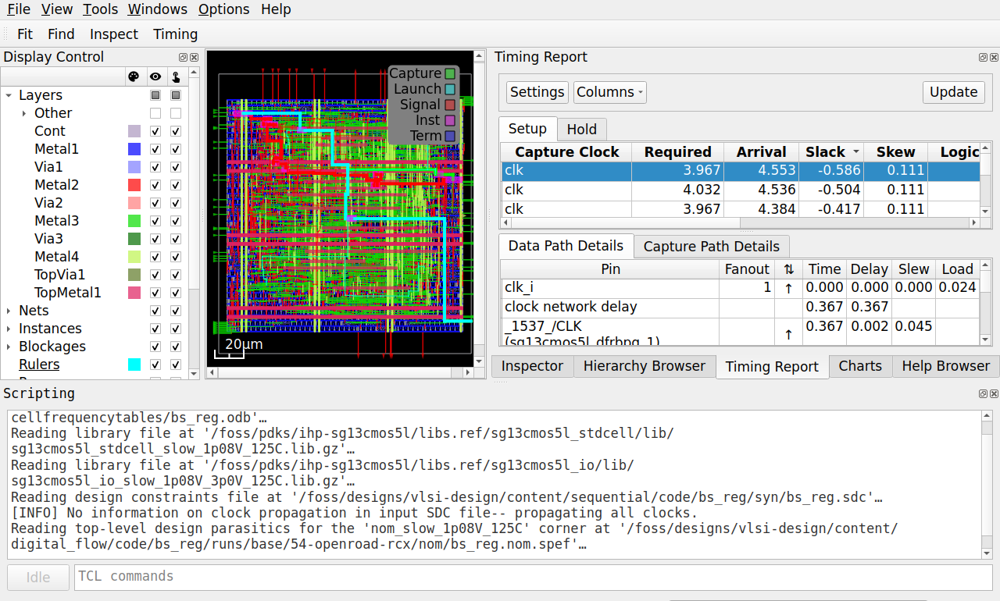

::: {.content-hidden}
Copyright (C) 2026 Simon Dorrer and co-authors (simon.dorrer@jku.at)
SPDX-License-Identifier: Apache-2.0
:::

# The RTL-to-GDSII Flow with LibreLane {#sec-digital-flow}

The netlists of the previous chapters exist only as text. To become a chip, every cell needs a place on the die, every net a wire in metal, and every clock a tree of buffers. The result must then pass the timing checks again, now with real wires, and checks that only a layout can fail: the design rules of the process and the comparison of the layout with the netlist. This chapter takes the barrel shifter between two registers of @sec-sequential-opensta through LibreLane [@LibreLane], the open-source RTL-to-GDSII flow of this course, from its RTL to a GDSII layout, one step at a time. It ends with the chip top level of the AMS chip template (@sec-intro-template), which puts such blocks into a padframe.

::: {.callout-note}
All code of this chapter is available in the folder [`content/digital_flow/code`](/tree/main/content/digital_flow/code) of the course repository: the LibreLane configuration, the equivalence check, and the testbench of the barrel shifter in `bs_reg/`, a small design with a clock gate in `cg_mix/`, and one with a divided clock in `div_mix/`. All numbers in this chapter come from the IIC-OSIC-TOOLS image `2026.10` (LibreLane 3.1.0.dev3 with its OpenROAD 26Q1, Yosys 0.70, Magic 8.3.685, KLayout 0.30.12, Netgen 1.5.324, EQY 0.70, Icarus Verilog 14.0) and SG13CMOS5L. The script [`scripts/check_digital_flow.sh`](/blob/main/scripts/check_digital_flow.sh) reproduces all of them: run `bash scripts/check_digital_flow.sh` in the container from the root of the repository. It runs LibreLane seven times, at most two at a time, opens the run `base` twice in the GUI without a screen, and takes about 35 minutes.
:::

For the exercises, clone the course repository into your designs folder once, if you have not done so yet:

```bash
cd /foss/designs
git clone https://github.com/iic-jku/vlsi-design.git
```

In every new terminal, define the path of the typical-corner library:

```bash
LIB=$PDK_ROOT/ihp-sg13cmos5l/libs.ref/sg13cmos5l_stdcell/lib
LIB=$LIB/sg13cmos5l_stdcell_typ_1p20V_25C.lib
```

## Learning Objectives {#sec-digital-flow-objectives}

After this chapter, you will be able to:

- run LibreLane on a block, find the results of every step in its run folder, and open the run in the OpenROAD GUI
- plan a floorplan: the size of the core, the rows, the power grid, and the pins
- explain what placement, buffering, clock tree synthesis, timing repair, and routing do to a netlist
- inspect a layout in the OpenROAD GUI: the clock tree, the routing congestion, the timing paths, and the IR drop
- read the signoff results in the reports of a run, timing in all corners, IR drop, DRC, and LVS, tell a finished flow from a clean design, and prove the final netlist equivalent to the RTL
- explain why the estimates before routing are optimistic, and close timing with the right setting
- simulate the final netlist with the delays of the layout, prove that they were annotated, and drive it as the SDC describes
- describe how a block becomes part of a chip with a padframe

## LibreLane {#sec-digital-flow-librelane}

LibreLane is a Python program that runs the tools of the flow one after the other: Verilator for the lint, Yosys for the synthesis, OpenROAD for floorplan, placement, clock tree, and routing, OpenRCX for the extraction, OpenSTA for the timing, Magic and KLayout for the layout and its design rules, and Netgen for the comparison of the layout with the netlist. Each **step** reads the state of the design that the previous step left, i.e., the netlist and the layout database, runs one tool, and writes the new state. **Checkers** between the steps stop the flow on errors, e.g., on unmapped cells, on wires that break a design rule, or on a failed comparison. A **flow** is a list of steps. The **Classic** flow of @fig-digital-flow-steps hardens a block from RTL to GDSII into a **macro**, a finished layout that a parent design places like a large cell, and the **Chip** flow of @sec-digital-flow-chip adds the padframe.



A YAML file configures the run: the name of the top module, the RTL files, the clock, the constraints, the floorplan, and the corners. Everything it does not set comes from the defaults of LibreLane and of the PDK, which `libs.tech/librelane/` of SG13CMOS5L holds. The configuration of `bs_reg` uses the SDC file of @sec-sequential-sdc for placement, routing, and signoff, a core with 50 % utilization, and the supply nets `VDD` and `VSS` of the AMS chip template. The corners come from the PDK: the typical, slow, and fast corners of @sec-synthesis-lib-corners for the nominal supply of 1.2 V, with the typical one as the default corner, which the timing reports between the steps use. LibreLane names each corner after the corner of the wires and the corner of the library, e.g., `nom_typ_1p20V_25C` for nominal wires and the typical library at 1.2 V and 25 °C:

```{.yaml filename="bs_reg/config.yaml"}

```

The run takes about six minutes. LibreLane writes each step into its own numbered folder of the run folder `runs/base/`, e.g., `06-yosys-synthesis/` or `35-openroad-cts/`, with the log of the tool, its reports, the exact commands in `COMMANDS`, and the state it hands on. The folder `final/` collects the results: the layout as GDSII (`gds/`), as DEF (Design Exchange Format, `def/`), and as OpenROAD database (`odb/`), the LEF abstract of the macro for a parent design (@sec-synthesis-lib-cells, `lef/`), the netlist without and with supply connections (`nl/`, `pnl/`), the extracted parasitics as SPEF (Standard Parasitic Exchange Format, `spef/`), the delays for a gate-level simulation per corner as SDF (@sec-verification-gl-sdf, `sdf/`), a timing model of the macro (`lib/`), the SPICE netlist extracted from the layout (`spice/`), and all metrics of the run in `metrics.json`.

### The OpenROAD GUI {#sec-digital-flow-gui}

The reports give the numbers of a run, and the GUI of OpenROAD shows the layout behind them. LibreLane opens a finished run in it with a flow of one step, `OpenInOpenROAD`, which needs the desktop of the container (@sec-intro-installation):

```bash
librelane config.yaml --pdk ihp-sg13cmos5l --pdk-root $PDK_ROOT \
  --manual-pdk --run-tag base --flow OpenInOpenROAD
```

The step reads the state that the last step of the run handed on, whose layout database equals the one in `final/odb/`, and the Liberty files, the SDC file, and the SPEF file of the default corner, with the propagated clock. The GUI therefore shows the timing of the typical corner only, and `-c DEFAULT_CORNER=nom_slow_1p08V_125C` opens the run in the slow corner instead. The GUI flow writes into the run like any other flow. Each time, it adds a numbered folder for its step, e.g., `77-openroad-opengui/`, appends its log to `flow.log`, saves the state that it opened into `final/` again, and replaces `resolved.json`, the complete configuration of the run, with its own, which no longer shows the settings of the Classic flow. The file `config.json` in the folder of each step keeps the settings that this step used.

@fig-digital-flow-gui shows the window. The layout fills the middle, with a scale bar at the bottom left. The Display Control on the left switches layers, nets, instances, rows, and heat maps on and off, and a double click on an underlined entry opens its settings. On the right, the Inspector shows the properties of the object under the last click, here the input buffer `input1`: its cell, its position, its orientation, and its pins. The tabs next to it hold the Hierarchy Browser, the Timing Report, and the Charts, and the menu `Windows` opens more, such as the Clock Tree Viewer. The Scripting pane at the bottom accepts every command of OpenROAD and OpenSTA, e.g., `report_checks` of @sec-sequential-opensta, and shows the files that the step read.

{#fig-digital-flow-gui fig-alt="Screenshot of a desktop application with a menu bar, a list of layers with check boxes on the left, a dense rectangular layout in the middle, a table of properties on the right, and a text console at the bottom."}

## Floorplan {#sec-digital-flow-floorplan}

The **die** is the rectangle of the macro, the **core** the area inside it where the cells stand. The margins between them hold the pins and, in a chip, a ring of supply wires. With `FP_SIZING: relative`, LibreLane derives the core from the area of the synthesized cells: `FP_CORE_UTIL: 50` makes the core twice as large as the cells, and the core is square unless an aspect ratio is set. The free half is not wasted. Placement adds buffers, clock tree synthesis adds a tree, timing repair enlarges cells, and the router needs free tracks above the cells. The other way is `FP_SIZING: absolute` with a fixed `DIE_AREA`, as in the counter of the AMS chip template.

The core is divided into **rows** of the height of a cell, 3.78 µm in SG13CMOS5L, made of **sites** of 0.48 µm width (@sec-synthesis-lib-cells). Every cell is a whole number of sites wide. Every second row is flipped, so that two neighboring rows share their supply rail. Many libraries need tap cells in every row, which tie the wells and the substrate to the supplies. The cells of SG13CMOS5L contain these ties themselves, so the PDK sets `FP_TAPCELL_DIST` to 0, and the flow inserts none.

The **power distribution network** (PDN) brings `VDD` and `VSS` to every row (@fig-digital-flow-floorplan). Metal1 rails run along the rows, where the cells connect to them. Vertical straps on Metal4, 1 µm wide every 50 µm, connect to the rails through stacks of vias, and horizontal straps on TopMetal1, 2 µm wide every 50 µm, connect to the Metal4 straps. The straps of both layers form the supply pins of the macro, to which the parent connects its own grid. The **pins** of the signals sit on the edges of the die, on Metal3 on the left and right and on Metal2 at the top and bottom, the layers whose preferred direction leads into the core. The IO placer orders them to keep the wires short, or follows a pin order file.



::: {.callout-tip title="Exercise: Plan the Floorplan"}
All commands start in the folder `content/digital_flow/code/bs_reg`. Start the run first, it takes about six minutes:

```bash
librelane config.yaml --pdk ihp-sg13cmos5l --pdk-root $PDK_ROOT \
  --manual-pdk --run-tag base
```

1. Sketch the floorplan of `bs_reg` with the core, the rows, the straps, and the pins, and add the numbers: the synthesis report `runs/base/06-yosys-synthesis/reports/stat.rpt` gives the area of the synthesized cells. Compute the core for 50 % utilization, its edge for a square core, and the number of rows and sites that fit.
2. Compare with the layout: `runs/base/final/def/bs_reg.def` holds the die (`DIEAREA`) and one `ROW` statement per row, in database units of 1 nm. How large are the die and the core, and how wide are the margins? Which utilization and cell area does `runs/base/final/metrics.json` report for the finished layout (`design__instance__utilization`, `design__instance__area__stdcell`), and how much area did the steps after the synthesis add?
3. Open the run in the GUI (@sec-digital-flow-gui), hide the signal and clock nets under `Nets` in the Display Control, and compare the straps on Metal4 and TopMetal1 with your sketch. A click on a strap shows its net in the Inspector, and the status bar at the bottom shows the coordinates under the pointer. Where do the straps of `VDD` and `VSS` lie (the section `SPECIALNETS` of the DEF file gives the exact positions), and why does `VSS` have one Metal4 strap less?
4. Run the flow again with a denser core and a higher density limit for the placement (`PL_TARGET_DENSITY_PCT`, @sec-digital-flow-place):

   ```bash
   librelane config.yaml --pdk ihp-sg13cmos5l --pdk-root $PDK_ROOT \
     --manual-pdk --run-tag util75 \
     -c FP_CORE_UTIL=75 -c PL_TARGET_DENSITY_PCT=85
   ```

   How do the utilization, the wire length (`route__wirelength`), the number of iterations of the detailed router (@sec-digital-flow-route, `route__drc_errors__iter:N`), and the worst setup slack in the typical corner change? Is a smaller core worth it here?
:::

Before continuing, please finish the previous exercise. Once you are done, compare with the solution below.

::: {.callout-tip title="Solution: Plan the Floorplan" collapse="true"}
1. The synthesized cells take 13,008.1 µm², so the core needs 26,016 µm², an edge of 161.3 µm. That fits 42 rows of 3.78 µm (158.76 µm) and 336 sites of 0.48 µm (161.28 µm). Metal1 rails run along the rows. Over the 161 µm of the core, the Metal4 straps every 50 µm make 4 for `VDD` and 3 for `VSS`, and TopMetal1 has 3 pairs. The pins sit on all four edges.
2. The rows fill 161.28 µm × 158.76 µm, 25,604.8 µm², with 42 rows of 336 sites. The die is 172.82 µm × 191.54 µm: the computed edge of 161.30 µm plus margins of 12 sites (5.76 µm) left and right and of 4 rows (15.12 µm) at the bottom and top. Of the computed square, 0.02 µm at the right and 2.54 µm at the top do not fill a whole site or row and stay empty. The finished layout reports 58.7 % utilization, 15,023.2 µm² of cells, because placement, clock tree synthesis, and timing repair added 2015 µm² of buffers and larger cells.
3. Every `VDD` strap has a `VSS` strap next to it. On Metal4, the 1 µm wide straps of the first pair have their centers at x = 15.76 µm and 18.76 µm, and a pair follows every 50 µm. On TopMetal1, the 2 µm wide straps of the first pair lie at y = 25.12 µm and 31.12 µm, again every 50 µm. The fourth Metal4 pair would place its `VSS` strap at x = 168.76 µm, beyond the right edge of the core at 167.04 µm, so only its `VDD` strap at 165.76 µm remains.
4. With 75 %, the core shrinks to 16,903 µm², and the finished layout fills 89.2 % of it. The detailed router starts with 1139 instead of 683 violations and needs 6 instead of 4 iterations, the wire length grows from 40,693 to 45,974 µm, and the worst setup slack in the typical corner drops from 1.075 to 0.997 ns. The core is 34 % smaller, but harder to route and slower. For a macro that the parent places in a fixed slot, the margin is worth more.
:::

## Placement {#sec-digital-flow-place}

**Global placement** spreads the cells over the core so that the total wire length is short and no region is denser than `PL_TARGET_DENSITY_PCT`. OpenROAD treats the cells like charges that repel each other, while the nets pull connected cells together, and the result still allows overlaps. After it, OpenROAD can **estimate** the wires for STA: it approximates each net by a tree through its pins and multiplies the length by a resistance and a capacitance per micron. LibreLane takes both from the technology LEF, averaged over the routing layers Metal2 to TopMetal1: 0.389 Ω/µm and 0.097 fF/µm, against 0.515 Ω/µm and 0.093 fF/µm for Metal2 alone.

Then the **repair of the design** fixes every net that breaks a limit of the library or the constraints: the maximum slew, the maximum capacitance, and the maximum fanout. The SDC of `bs_reg` sets no fanout limit, so the default of the Liberty file applies, 8 loads (`default_max_fanout`). A design without an SDC file of its own gets the SDC of LibreLane, which sets the 10 loads of the PDK (`MAX_FANOUT_CONSTRAINT`). For `bs_reg`, OpenROAD first puts a `buf_1` behind each of the 40 inputs and in front of each of the 32 outputs, which separates the inside of the macro from its surroundings. It then finds 5 nets with too slow a slew and 30 nets with more than 8 loads, and inserts 142 more buffers into them. Synthesis did not do this: LibreLane's default synthesis strategy, `AREA 0`, lets ABC insert buffers only when `SYNTH_ABC_BUFFERING` is set, which is off by default, so its netlist has no buffers at all (@sec-synthesis-lib-yosys). **Detailed placement** finally moves every cell onto a site of a row, without overlaps.

## Clock Tree Synthesis {#sec-digital-flow-cts}

Until now, the timing analyses of our designs assumed an ideal clock that reaches every flip-flop at the same moment (@sec-sequential-sdc). In reality, one clock pin cannot drive dozens of flip-flops spread over the core. **Clock tree synthesis** (CTS) builds a tree of buffers from the clock pin to every flip-flop, so that the clock edge reaches all of them after about the same delay, the **latency**, with a small difference, the **skew**. TritonCTS, the CTS of OpenROAD, builds an **H-tree**: it divides the region of the flip-flops recursively into halves, connects the halves with branches of equal length, and places buffers along the tree that drive the branches and the flip-flops. It chooses from the clock buffers that the PDK lists, `buf_8` down to `buf_1`, with `buf_8` at the root. From now on, STA uses the **propagated** clock, i.e., the real arrival time of the clock at each flip-flop.

Skew moves time from one check to the other (@sec-sequential-hold): a capturing flip-flop whose clock arrives late gains setup time and loses hold time. After CTS, OpenROAD therefore repairs the timing with the real clock: it enlarges cells and adds buffers on paths that violate setup, and it inserts delay cells, `dlygate4sd1_1` to `dlygate4sd3_1`, into paths that violate hold, up to the margins `PL_RESIZER_SETUP_SLACK_MARGIN` and `PL_RESIZER_HOLD_SLACK_MARGIN` (0.05 and 0.1 ns by default). The candidates for hold violations are short paths, in which one flip-flop drives the next directly, as in the scan chains of @sec-dft.

A clock gate (@sec-synth-opt-cg) sits inside the clock tree, and the flip-flops behind it see its delay on top of the tree. TritonCTS balances this extra delay. The design `cg_mix` has two 16-bit registers on one clock, one of them behind an `lgcp_1`. CTS builds one tree behind the clock gate and one for the ungated register, reports that it balances the latency of the clock, and inserts three `buf_8` as delay buffers in front of the tree of the ungated register. In the typical corner, the rising clock edge then reaches all 32 flip-flops between 0.437 and 0.440 ns after the clock pin.

A divided clock (@sec-modeling-clken) gets no such help. In `div_mix`, a flip-flop divides `clk_i` by two, and a 16-bit register on the divided clock takes over the value of a register on `clk_i`. Its SDC file defines the divided clock with `create_generated_clock` (@sec-sequential-genclk). CTS finds two clock nets, `clk_i` and the output `div_q` of the divider, and builds a tree for each without balancing them against each other. The flip-flops behind the divider therefore see the clock later, by the clock-to-output delay of the divider and the delay of the second tree, and after CTS all 16 paths from `clk_i` into the divided clock violate hold, by up to 0.25 ns in the typical corner. The timing repair fixes them with 32 delay cells, two in front of each flip-flop. A clock enable on `clk_i` needs neither the second tree nor the delay cells.

The Clock Tree Viewer of the GUI (menu `Windows`) draws the tree of each clock in a tab of its own, named after the clock of the SDC file, after a click on `Update` (@fig-digital-flow-gui-cts-cg and @fig-digital-flow-gui-cts-div). The source of the clock sits at the top, and each buffer and each flip-flop sits at the latest time when the rising clock edge reaches it, in the corner chosen at the top left, so a balanced tree ends in one flat row of flip-flops. In `cg_mix`, the gated branch passes two `buf_8`, the clock gate (drawn as a circle), and one more `buf_8` before its four leaf buffers, and the ungated branch passes the three delay buffers and two more `buf_8`. Both end in the same row, at 0.44 ns. In `div_mix`, the tab `clk` shows the 17 flip-flops on `clk_i`, the divider included, which see the edge after about 0.14 ns. The tab `clk_div` starts at the output of the divider, after about 0.3 ns, and its 16 flip-flops see the edge only after about 0.49 ns. This difference causes the hold violations, which the repair fixes with delay cells.

::: {layout-ncol=2}

{#fig-digital-flow-gui-cts-cg fig-alt="Clock tree drawing with time increasing downward: a red triangle at the top, two branches of blue triangles, one of them with a pink circle, ending in one row of blue leaf triangles with small red squares below them."}

{#fig-digital-flow-gui-cts-div fig-alt="Clock tree drawing with a time axis from 0.30 to 0.50 ns: a red triangle at about 0.32 ns, one blue triangle below it, four blue leaf triangles, and rows of small red squares at about 0.49 ns."}

:::

::: {.callout-tip title="Exercise: Follow the Clock and the Reset"}
All commands start in the folder `content/digital_flow/code/bs_reg` and use the run `base` of the previous exercise.

1. Sketch the clock tree of `bs_reg` from the log of CTS, `runs/base/35-openroad-cts/openroad-cts.log`: how many flip-flops does it drive, how many buffers did it create, how many buffers are in each clock path, and how many flip-flops does each last buffer drive? What are the dummy loads that CTS reports?
2. Open the run in the GUI and its Clock Tree Viewer, and compare the tree with your sketch. Between which times does the clock edge reach the flip-flops? Compare this spread with the latencies in `clock.rpt` in the folder of the typical corner, `runs/base/55-openroad-stapostpnr/nom_typ_1p20V_25C/`, and with the worst setup skew of the corner in `runs/base/final/metrics.json` (`clock__skew__worst_setup__corner:...`). The file `skew.max.rpt` in the same folder shows how STA computes its skew.
3. Which output drives the only fanout violation of the run (`checks.rpt` in the same folder), and why did the repair of the design not fix it?
4. The reset input `rst_ni` drives the `RESET_B` pins of all flip-flops. Follow it in the final netlist `runs/base/final/nl/bs_reg.nl.v`: how many buffers lie between `rst_ni` and a flip-flop at most, and how many `RESET_B` pins does one buffer drive at most? How large is the worst recovery slack in the typical and the slow corner? The path that starts at `rst_ni` in the file `max.rpt` of each corner shows it.
5. No path needed a hold repair. Ask for a larger hold margin and run again:

   ```bash
   librelane config.yaml --pdk ihp-sg13cmos5l --pdk-root $PDK_ROOT \
     --manual-pdk --run-tag hold05 \
     -c PL_RESIZER_HOLD_SLACK_MARGIN=0.5
   ```

   Which of the delay cells did the flow choose, how many did it insert, and how much area do they cost? Is the margin reached?
:::

Before continuing, please finish the previous exercise. Once you are done, compare with the solution below.

::: {.callout-tip title="Solution: Follow the Clock and the Reset" collapse="true"}
1. The clock net `clk_i` has 71 sinks. CTS builds an H-tree with 17 `buf_8`: one at the root, which drives 16 leaf buffers, and each leaf drives 4 or 5 flip-flops (9 × 4 + 7 × 5 = 71). Every clock path has exactly 2 buffers. The 9 leaves with only 4 flip-flops get a **dummy load**, an `inv_1` whose output stays open, so that all 16 leaves carry about the same load and the same delay. Together they make the 80 sinks that the log reports.
2. The viewer shows the tree of the sketch (@fig-digital-flow-gui-cts-bs): the root, 16 leaves, and the 71 flip-flops in one row, reached between 0.237 and 0.250 ns, a spread of only 0.013 ns. `clock.rpt` gives 0.225 to 0.250 ns, because STA computes an early and a late arrival at each flip-flop. The early analysis takes the smaller value of each pin capacitance, which the library gives as a range (`rise_capacitance_range`), and the report combines the early arrival at `_1508_` with the late one at `_1482_`. The viewer draws the late arrivals only. The worst setup skew in `metrics.json` is 0.118 ns in the typical corner, 0.124 ns in the slow and 0.116 ns in the fast one. `skew.max.rpt` shows how STA gets there: it takes the late clock at a launching flip-flop (0.250 ns at `_1482_`) minus the early clock at a capturing one (0.225 ns at `_1508_`), adds the clock uncertainty of 0.1 ns from the SDC (@sec-sequential-path), and subtracts 0.007 ns of clock reconvergence pessimism, the early and late difference on the part that both clock paths share (@sec-sequential-opensta). The metric is a margin for the setup check, not the spread of the tree.
3. The fanout violation belongs to the root buffer `clkbuf_0_clk_i`, which drives 16 leaves against a limit of 8. The repair of the design ran before CTS and skips clock nets anyway, and CTS groups the sinks by the load its buffers can drive, not by the fanout limit.
4. The repair of the design turned the reset net into a tree of 13 `buf_1`, the input buffer included, and the `RESET_B` pins hang on 12 of its nets, with 2 to 8 pins each. At most five buffers lie between `rst_ni` and a flip-flop. In @sec-sequential-opensta, one `buf_2` drove all 71 pins with a slew of 0.87 ns. The tree splits this load, at the price of more delay, which the recovery check easily allows: its worst slack is 1.912 ns in the typical and 1.356 ns in the slow corner.
5. The flow inserts 131 `dlygate4sd3_1`, the delay cell with the largest delay, and the area of the cells grows by 14 %, from 15,023.2 to 17,162.4 µm². The resizer still warns that it cannot repair all hold checks within the margin: it reaches only 0.22 ns on its estimates, and at signoff the fast corner has 0.268 ns, far below the 0.5 ns asked for. Hold margin costs area, so the default asks for 0.1 ns only.

{#fig-digital-flow-gui-cts-bs fig-alt="Clock tree drawing with time increasing downward: a red triangle and one blue triangle at the top, a row of sixteen small blue triangles at about 0.13 ns, and red squares in a nearly flat row at about 0.24 ns."}
:::

## Routing {#sec-digital-flow-route}

**Global routing** divides the die into a grid of tiles, assigns each net a path through the tiles and a layer, and counts the demand of each tile against its tracks. A tile with more demand than tracks is **congested**, and the router detours nets around it. For `bs_reg`, the global router uses 44 % of the tracks of Metal2 and 39 % of Metal3, 28 % of all tracks, without overflow, i.e., no tile is congested. STA can now use the global routes instead of the estimates of the placement. LibreLane can also repair the timing once more on them, but this step (`RUN_POST_GRT_RESIZER_TIMING`) is off by default. Global routing also checks the **antenna rule**: while a wire is being manufactured, it collects charge, and a long wire that ends at a gate can damage the gate oxide before the upper metal connects it to a diffusion that drains the charge. The fix is a jumper to a higher layer or a diode cell, `antennanp` in SG13CMOS5L, next to the gate. `bs_reg` has no violation and needs no diode.

**Detailed routing** with TritonRoute draws every wire on the tracks of its layer, with the widths, spacings, and vias that the design rules demand. It starts from a first solution with violations and repairs them in iterations: for `bs_reg`, 683 violations after the first iteration, then 355 and 296, and none after the fourth. The routed wires are 40,693 µm long, and the longest net 436 µm.

After routing, **fill insertion** closes the gaps in the rows with filler cells, which continue the wells and the rails, and with decoupling capacitors (@sec-synthesis-lib-cells): 634 `decap_8` and 151 `decap_4`, which hold charge between `VDD` and `VSS` where cells switch, and 255 `fill_2` and 280 `fill_1` in the gaps that are too small for them. @fig-digital-flow-layout shows the finished layout.

{#fig-digital-flow-layout width="80%" fig-alt="Layout of a rectangular block, slightly taller than wide, densely filled with rows of standard cells and covered by a mesh of vertical and horizontal wires, with pins along all four edges."}

The GUI shows the global routing as a heat map, `Routing Congestion` under `Heat Maps` in the Display Control. It reads the grid of tiles that the global router stores in the layout database, 7.2 µm wide for `bs_reg`, and colors each tile by the share of its routing capacity in use: for all layers, the larger share of the two directions, horizontal (Metal3 and TopMetal1) and vertical (Metal2 and Metal4), or, after a double click on the entry, the share of one layer. To see the map that the global router left, open the state that its step handed on, with `--with-initial-state`, under a run tag of its own:

```bash
librelane config.yaml --pdk ihp-sg13cmos5l --pdk-root $PDK_ROOT \
  --manual-pdk --run-tag base_grt --flow OpenInOpenROAD \
  --with-initial-state \
  runs/base/39-openroad-globalrouting/state_out.json
```

The own run tag matters. The GUI step hands on the state that it opened and saves it into `final/` of its run. In the run `base` itself, the layout and the metrics in `final/` would turn into those of the global routing, and every later GUI session would open the global routing again. `base_grt` gets only the folder of the GUI step and its own `final/`. `gui::dump_heatmap Routing heat.csv` in the Scripting pane writes the value of every tile into a file.

@fig-digital-flow-gui-congestion shows the map of `base` with the signal and clock nets hidden. The middle of the core is the fullest, 82 % on average in the middle half of the core in x and in y, against 38 % in the margins around the core, and 10 tiles reach 100 %, 8 of them in the middle. A full tile uses all its tracks, but it is not congested, because no tile overflows. The other heat maps work the same way: the placement density, RUDY (Rectangular Uniform wire Density, a quick estimate of the routing demand from the placement alone), the power density, the pin density, and the IR drop of @sec-digital-flow-signoff.

{#fig-digital-flow-gui-congestion fig-alt="Layout with a colored grid of square tiles over it: dark red tiles in the middle of the core, orange and yellow around them, and green and turquoise tiles along the edges, next to a color legend from 0 to 100 percent."}

::: {.callout-tip title="Exercise: Find the Congestion"}
All commands start in the folder `content/digital_flow/code/bs_reg` and use the runs `base` and `util75` of the first exercise.

1. Sketch the core of `util75` next to the core of `base` from the first exercise, at the same scale, and shade where you expect the routing to be fullest.
2. Open `util75` at the state after global routing and show its routing congestion map:

   ```bash
   librelane config.yaml --pdk ihp-sg13cmos5l --pdk-root $PDK_ROOT \
     --manual-pdk --run-tag util75_grt --flow OpenInOpenROAD \
     --with-initial-state \
     runs/util75/39-openroad-globalrouting/state_out.json
   ```

   Where are the full tiles now, and how many tiles reach 90 % and 100 %, compared with `base`? Count them in the file of `gui::dump_heatmap`. Compare the usage per layer in the log of the global routing of both runs, the table after `GRT-0096` in `runs/<run>/39-openroad-globalrouting/openroad-globalrouting.log`.
3. Choose Metal4 alone in the settings of the map. Why does the map of `util75` show bright columns, and why does it read 30 % or more even between them, although the log of `util75` gives Metal4 only 13 % of usage?
4. Open the final state of `util75` with `--run-tag util75` and without `--with-initial-state`, and show the map again. What do you see, and why does this chapter open the state of the global routing for this map?
:::

Before continuing, please finish the previous exercise. Once you are done, compare with the solution below.

::: {.callout-tip title="Solution: Find the Congestion" collapse="true"}
1. The denser core holds the same cells and nets on a third less area, so expect more demand everywhere, and most of it in the middle, as in `base`.
2. After global routing, the map of `util75` is full almost everywhere in the core (@fig-digital-flow-gui-congestion-u75-grt): 152 of its 418 tiles reach 90 % or more and 33 reach 100 %, against 60 of 624 and 10 in `base`, and the margins around the core reach 57 % on average instead of 38 %. The log agrees. The global router uses 45.65 % of all tracks instead of 28.20 %, 58.89 % of Metal2 and 64.18 % of Metal3 instead of 43.96 % and 38.85 %. No tile overflows, but full tiles leave the router no room for detours, so the detailed router starts with 1139 instead of 683 violations (first exercise).
3. The bright columns lie on the Metal4 straps of the power grid, at x = 16, 66, and 116 µm, where the map reads 57 to 68 % instead of 31 to 48 % between them. The map counts the tracks under a strap as used. It also counts the 30 % of the tracks of every layer that the global router keeps free for the detailed router (`GRT_ADJUSTMENT` of 0.3 in `config.json` of the step), so even a layer with few wires reads 30 % or more. The log counts only the tracks that are left, and of those the routes use 13 % on Metal4.
4. The final database of `util75` holds a different map (@fig-digital-flow-gui-congestion-u75-final): at most 57 %, 38 % on average, cooler than `base` after global routing. In `util75`, the antenna repair after global routing found 6 violations, inserted 6 diodes, and routed the affected nets again (`42-openroad-repairantennas/`), and the global router then stored a new grid, in which most tiles hold little more than the reserve and the straps. `base` has no antenna violation, so it keeps the map of the global routing, which makes the difference easy to miss. The map of a final state need not show the global routing, so open the state of the global routing for it, and compare it with the log of the global router.

::: {layout-ncol=2}

{#fig-digital-flow-gui-congestion-u75-grt fig-alt="Layout with a colored grid of tiles that are dark red over almost the whole core, and red to turquoise in the margins around it."}

{#fig-digital-flow-gui-congestion-u75-final fig-alt="The same layout with turquoise and blue tiles only, and orange spots where the power straps cross."}

:::
:::

## Signoff {#sec-digital-flow-signoff}

Only now are the wires known. **Parasitic extraction** with OpenRCX computes the resistance of every wire and its capacitance to ground and to its neighbors from the routed layout and the rules of the PDK, and writes them as SPEF. STA reads the SPEF instead of the estimates, and it writes SDF files with the delays of every cell and every wire, which a gate-level simulation can back-annotate (@sec-digital-flow-postlayout). The **signoff STA** checks setup and hold in every corner, the slow corner for setup and the fast one for hold in particular, and LibreLane collects the results in `55-openroad-stapostpnr/summary.rpt`.

@fig-digital-flow-slack follows the worst setup slack through the run. The synthesized netlist misses the 4 ns clock, because ABC left the high-fanout nets unbuffered. After the repair of the design and CTS, the slack is positive, and the timing repair adds to it. Then the slack shrinks again, from 1.45 ns after the timing repair to 1.08 ns: the global routes cost 0.11 ns, and the extracted wires another 0.26 ns. The estimates before routing are optimistic: real wires take detours and change layers through vias, and the extraction counts the capacitance between neighboring wires, which the estimate per micron does not.



The Timing Report of the GUI lists the worst paths of the default corner for setup and hold. `Update` fills the list, and a click on a path draws it into the layout: the clock path of the launching flip-flop, the data path, and the clock path of the capturing flip-flop, each in its own color, while the table below lists the path pin by pin, as `max.rpt` does. The Charts show how many endpoints reach which slack (`Endpoint Slack`). Both cover the default corner only (@sec-digital-flow-gui).

Besides timing, the signoff checks the layout itself:

- **IR drop.** OpenROAD computes the voltage drop in the power grid for the estimated currents of the cells. The worst drop on `VDD` in `bs_reg` is 1.33 mV, 0.11 % of the 1.2 V supply, and `VSS` rises by at most 1.99 mV.
- **DRC.** Magic and KLayout check the GDSII against the design rules of the PDK, with 0 violations each for `bs_reg`. KLayout also compares the GDSII files that Magic and KLayout stream out (an XOR, 0 differences).
- **LVS.** Magic extracts a netlist from the layout, and Netgen compares it with the netlist with supply connections (`pnl/`): "Circuits match uniquely". In the flow, the cells are abstracts, boxes with their pins and nothing inside, so the comparison covers the connections between the cells and not the transistors inside them. The AMS chip template can also run a full LVS of the GDSII with KLayout (`make klayout-lvs`).
- **Antenna.** A second antenna check on the routed layout, with 0 violations.

In the GUI, `analyze_power_grid -net VDD` in the Scripting pane repeats the IR drop analysis of the flow, and the heat map `IR Drop` then shows where the drop arises (@fig-digital-flow-gui-irdrop). On `VDD`, it is largest in the top rows of the core, at about x = 50 µm and y = 155 µm, halfway between two Metal4 straps. The configuration of `bs_reg` names no voltage sources (`VSRC_LOC_FILES`), so OpenROAD holds the pins of the net at the supply voltage, here all straps on Metal4 and TopMetal1 (@sec-digital-flow-floorplan), and the drop arises only in the via stacks and the Metal1 rails between them. `warning.log` warns that this may make the result inaccurate, and adds that only a top-level chip for manufacture needs to care.

{#fig-digital-flow-gui-irdrop fig-alt="Screenshot of the OpenROAD window: a layout covered by horizontal bands of colored tiles, red at the top and in two bands lower down, blue and green in between, a legend from 0 to 1.33 mV, and a text report below with a worst case IR drop of 1.33e-03 V."}

One more check proves that the netlist still does what the RTL describes. The layout flow changed it: buffers, a clock tree, resized cells, and delay cells. LibreLane's own equivalence step prepares the cell models only for sky130, so we run EQY ourselves on the final netlist, with the setup of @sec-synthesis-lib-lec. Flattening the RTL keeps the net names of the submodule `u_shift` as second names of the nets of `bs_reg`, which would confuse the matching, so both sides hide the hierarchical names:

```{.default filename="bs_reg/lec.eqy"}

```

::: {.callout-tip title="Exercise: Close the Timing"}
All commands start in the folder `content/digital_flow/code/bs_reg` and use the run `base` of the first exercise.

1. Sketch the worst path of the failing corner. Open `runs/base/55-openroad-stapostpnr/summary.rpt`: which corner fails, by how much, and at how many endpoints? Then draw the worst path of that corner from the file `max.rpt` in the folder of the corner: where does it start, through which cells does it run, and where does it end?
2. Open the run in the GUI in the failing corner (`-c DEFAULT_CORNER=<corner>`, @sec-digital-flow-gui) and draw the worst setup path of the Timing Report into the layout. `Find` in the toolbar selects an instance by its name, and the Inspector shows its position. Where on the die do the first and the last flip-flop of the path sit, and why does the path cross so much of the core? Choose `Endpoint Slack` in the Charts: does the histogram agree with `summary.rpt`, and how many endpoints fail by more than 0.5 ns?
3. The timing repair after CTS worked on all corners. Read its log, `runs/base/37-openroad-resizertimingpostcts/openroad-resizertimingpostcts.log`: from which worst slack did it start, and which did it reach? How much slack did the slow corner lose between the repair and signoff, compared with the typical corner in @fig-digital-flow-slack?
4. Try a delay-oriented synthesis first, `-c SYNTH_STRATEGY="DELAY 4"` with `--run-tag delay4`. What happens to the slack in the slow corner and to the area of the cells (`design__instance__area__stdcell`)?
5. Ask the repair for a setup margin of 0.6 ns, `-c PL_RESIZER_SETUP_SLACK_MARGIN=0.6` with `--run-tag margin`. Why this value? Do all corners pass now, and at which cost in area?
6. The resizer changed the netlist. Prove that the final netlist of `runs/base` still implements the RTL:

   ```bash
   ln -sf $LIB stdcell.lib
   eqy -f -d lec_eqy lec.eqy
   ```

   What does EQY report? Then replace the first `sg13cmos5l_a21oi_1` in the file by `sg13cmos5l_o21ai_1` in a copy of the netlist, point `read_verilog` in a copy of `lec.eqy` to it, and check again.
:::

Before continuing, please finish the previous exercise. Once you are done, compare with the solution below.

::: {.callout-tip title="Solution: Close the Timing" collapse="true"}
1. The slow corner fails with a worst setup slack of -0.586 ns at 31 endpoints, with a total of -6.98 ns, while the typical corner has 1.075 ns and the fast corner 2.072 ns. Hold passes everywhere, with 0.204 ns in the fast corner. The worst path starts at `_1537_`, the flip-flop of `shamt_q[1]`, and ends at the input of a flip-flop of `out_q`. Of the 3.59 ns from the output of the first flip-flop to the input of the second, 1.83 ns go into six buffers of the repair of the design: two behind the flip-flop, whose output drove 36 loads before the repair, and a chain of four behind an XNOR gate, whose output drove 53. The rest goes into the XNOR gate, two multiplexers, and four other gates.
2. The GUI draws the path across the core (@fig-digital-flow-gui-timing). It starts at `_1537_` in the top left corner, at x = 10.1 µm and y = 162.5 µm, next to the input pin `shamt_i[1]` that feeds it, and ends at `_1516_` near the right edge, at x = 153.6 µm and y = 117.2 µm, next to the output pin `data_o[12]` that it drives. Both flip-flops sit next to their pins, on opposite sides of the die, so the logic between them has to cross the core. The histogram agrees with `summary.rpt`: 31 endpoints below 0 ns, 2 of them below -0.5 ns.
3. The repair started at -0.725 ns, the worst slack over all corners, i.e., in the slow corner, resized 8 cells, removed one buffer, and reached +0.031 ns on its estimates, below its margin of 0.05 ns, so it reported that it could not repair all violations. After routing, the slow corner ends at -0.586 ns, so it lost 0.62 ns on the way to signoff, against 0.38 ns in the typical corner. The estimates before routing are optimistic, and the slow corner suffers most, because its weaker cells turn the same extra capacitance into more delay.
4. With `DELAY 4`, the slow corner improves only to -0.542 ns, while the area of the cells grows by 12 % to 16,852.1 µm². The synthesis was not the problem: the repair reached 0.088 ns on its estimates, above its margin, and the wires again took 0.63 ns.
5. The margin covers the loss of about 0.6 ns that the slow corner showed in the third step. With it, all corners pass: 0.048 ns in the slow corner, 1.512 ns in the typical corner. The cells take 15,170.2 µm², only 1 % more than in `base`. The right knob depends on the mechanism: here the estimate before routing was the problem, not the logic.
6. EQY proves the designs equivalent in 32 partitions, one per output bit, in less than half a minute. With the replaced cell, it fails the partitions of two output bits, `data_o[1]` and `data_o[17]`. The equivalence check belongs after every step that changes the netlist, and the layout flow changes it a lot.

{#fig-digital-flow-gui-timing fig-alt="Screenshot of the OpenROAD window with a highlighted path that runs from the top left of the layout across to the right edge, and a table of paths with slacks of -0.586, -0.504, and -0.417 ns."}
:::

### The Reports of a Run {#sec-digital-flow-reports}

The run `base` ends with `Flow complete.`, and still its slow corner fails. Besides a step that ends with an error, only a failing checker makes a run fail (@sec-digital-flow-librelane), and each checker of the timing counts only the corners in its own variable. The PDK sets `TIMING_VIOLATION_CORNERS` to the typical corners (`*typ*`), so the checker of the setup violations only warns about the slow corner in `flow.log` and `warning.log`. `HOLD_VIOLATION_CORNERS` covers all corners (`*`), so a hold violation in any corner fails the run, and the checkers of the maximum slew and capacitance count no corner at all. The report `manufacturability.rpt` at the end of the run says `Passed` for antenna, LVS, and DRC, and nothing about the timing. A finished flow is therefore not necessarily a clean design. After every run, read the reports of @tbl-digital-flow-reports, and `final/metrics.json`, which collects most of their numbers.

| Question | Folder in `runs/base/` | Report |
|:-----------------------------|:------------------------------|:-------------------------|
| Which steps warned or failed? | the run folder | `warning.log`, `error.log` |
| Which settings did a step use? | the folder of the step | `config.json` |
| How large is the synthesized netlist? | `06-yosys-synthesis/reports/` | `stat.rpt` |
| Is the timing met in every corner? | `55-openroad-stapostpnr/` | `summary.rpt` |
| Which paths fail, and by how much? | `55-openroad-stapostpnr/<corner>/` | `max.rpt`, `min.rpt`, `violator_list.rpt` |
| Which slew, capacitance, and fanout limits fail? | the same | `checks.rpt` |
| How large are the latency and the skew? | the same | `clock.rpt`, `skew.max.rpt` |
| How much power does the block take? | the same | `power.rpt` |
| How large is the IR drop? | `56-openroad-irdropreport/` | `irdrop.rpt` |
| Are there antenna violations? | `46-openroad-checkantennas-1/reports/` | `antenna_summary.rpt` |
| Does the layout pass DRC? | `64-magic-drc/reports/`, `65-klayout-drc/reports/` | `drc.magic.rpt`, `drc.klayout.json` |
| Does the layout match the netlist? | `70-netgen-lvs/reports/` | `lvs.netgen.rpt` |
| Do antenna, LVS, and DRC pass? | `76-misc-reportmanufacturability/` | `manufacturability.rpt` |

: The reports of the run `base` and the questions they answer. `<corner>` stands for the folder of a corner, e.g., `nom_slow_1p08V_125C/`. {#tbl-digital-flow-reports}

::: {.callout-tip title="Exercise: Read the Reports"}
All commands start in the folder `content/digital_flow/code/bs_reg` and use the run `base` of the first exercise.

1. Draw the power grid of `bs_reg` from the first exercise again, with the straps of `VDD` and `VSS` on Metal4 and TopMetal1, and mark where you expect `VSS` to rise most, compared with the drop of `VDD` in @fig-digital-flow-gui-irdrop.
2. Open the run in the GUI, analyze the ground net with `analyze_power_grid -net VSS`, and show its map: a double click on `IR Drop` in the Display Control opens the settings, where you choose the net. Where does `VSS` rise most, and why there? Compare the report of the analysis with `irdrop.rpt`.
3. Count the lines of `warning.log` by their text, with `sort runs/base/warning.log | uniq -c`. Which warnings concern the run, and which only the tools?
4. Which group in `power.rpt` of the typical corner takes the most power, and which share goes into the clock tree?
:::

Before continuing, please finish the previous exercise. Once you are done, compare with the solution below.

::: {.callout-tip title="Solution: Read the Reports" collapse="true"}
1. `VSS` has its straps next to those of `VDD` and should behave the same, with one exception: the fourth Metal4 pair on the right has no `VSS` strap (first exercise).
2. `VSS` rises most at the right edge of the core, by 1.99 mV at about x = 160 µm and y = 65 µm (@fig-digital-flow-gui-irdrop-vss), as `irdrop.rpt` reports (`Worstcase voltage: 1.99e-03 V`). There, the nearest Metal4 strap of `VSS`, at x = 118.76 µm, lies about 40 µm away, while `VDD` has its fourth strap at x = 165.76 µm. The Metal1 rails of `VSS` right of x = 118.76 µm get their current from one side only. The worst rise per column of tiles stays near 1.75 mV left of the last strap of `VSS` and grows to 1.99 mV toward the right edge.
3. Of the 37 lines, 25 are `ORD-0032` about the number of threads that LibreLane passes to OpenROAD, and 7 are `DRT-0349` about rules of the technology LEF that the detailed router skips. They concern only the tools. The remaining 5 concern the run: the setup violations in the slow corner (two lines), `RSZ-0062` of the repair that could not fix them, the missing voltage sources of the IR drop analysis, and a checker of long wires that was skipped, because no threshold was set.
4. The sequential cells take 45.1 % of the 2.33 mW, the combinational cells 32.0 %, and the clock tree 22.9 %. The flip-flops and the clock tree switch in every cycle and take two thirds together, which is why clock gating (@sec-synth-opt-cg) pays.

{#fig-digital-flow-gui-irdrop-vss fig-alt="Screenshot of the OpenROAD window with a layout covered by horizontal bands of colored tiles, red at the top and at the right edge, a legend from 0 to 1.99 mV, and a text report with a worst case IR drop of 1.99e-03 V."}
:::

## Post-Layout Simulation {#sec-digital-flow-postlayout}

Signoff STA checks every path, and EQY proves the function of the final netlist, but neither of them runs it. The last simulation does: the testbench of the block on the final netlist, with the delays of the layout. It is the timing simulation of @sec-verification-gl-sdf, with three differences:

- **The wires.** The SDF files of the layout hold the delay of every connection from a driver to a load, computed from the extracted parasitics, as `INTERCONNECT` entries, 2672 of them for `bs_reg`. They must stay in the file, and Icarus Verilog annotates them only with the option `-ginterconnect`.
- **The clock tree.** The clock no longer reaches all flip-flops at once. Each flip-flop sees an edge of `clk_i` late by the delays of the buffers and wires of its path through the tree (@sec-digital-flow-cts), as in STA after CTS.
- **The corners.** LibreLane writes one SDF file per corner into `final/sdf/`, e.g., `nom_slow_1p08V_125C/bs_reg__nom_slow_1p08V_125C.sdf`, each with the triples of its corner. The option `-Tmin`, `-Ttyp`, or `-Tmax` of `iverilog` selects which value of each triple the simulation uses, and `-Ttyp` is the default.

The testbench `tb/tb_bs_reg.sv` applies random inputs to `bs_reg` in every cycle and compares `data_o` with a reference model of the barrel shifter two cycles later. It plays the environment that the SDC of @sec-sequential-sdc describes: it changes the inputs 1.0 ns after each rising edge of `clk_i`, the input delay, and checks `data_o` 1.0 ns before the next edge, the output delay. Plusargs change the period, the drive and sample times (`+DRIVE`, `+SAMPLE`), the number of cycles, and how many mismatches it prints, and `+SDF=<file>` annotates an SDF file with `$sdf_annotate()`:

```{.systemverilog filename="bs_reg/tb/tb_bs_reg.sv"}

```

The same testbench runs on the RTL and, with the cell models, on the final netlist without supply connections, `final/nl/bs_reg.nl.v`. Its decap and fill cells are empty modules in the cell models:

```bash
cd /foss/designs/vlsi-design/content/digital_flow/code/bs_reg
iverilog -g2012 -o rtl.vvp \
  ../../../verification/code/barrel_shift/rtl/barrel_shift.sv \
  ../../../sequential/code/bs_reg/rtl/bs_reg.sv tb/tb_bs_reg.sv
vvp -n rtl.vvp
CELLS=$PDK_ROOT/ihp-sg13cmos5l/libs.ref/sg13cmos5l_stdcell/verilog
iverilog -g2012 -gspecify -ginterconnect -o pl.vvp \
  $CELLS/sg13cmos5l_udp.v $CELLS/sg13cmos5l_stdcell.v \
  runs/base/final/nl/bs_reg.nl.v tb/tb_bs_reg.sv
C=nom_typ_1p20V_25C
vvp -n pl.vvp +SDF=runs/base/final/sdf/$C/bs_reg__$C.sdf
```

Both runs report `2000 cycles, 0 errors`. For the RTL, Icarus Verilog warns that it omits `$sdf_annotate()` without `-gspecify`, which is harmless there. For the netlist, the compiler prints the 68 `sorry` messages of @sec-verification-gl-sdf and warnings that timing checks are not supported. The simulation prints 71 warnings `TIMINGCHECK not supported`, one per flip-flop, and two errors `Chosen value not defined` for the header lines `VOLTAGE` and `TEMPERATURE`, whose triples lack the typical value. Unlike the SDF file of @sec-verification-gl-sdf, the file of LibreLane needs no editing, and all its `INTERCONNECT` entries are annotated. Icarus Verilog fails on entries from a bit of an input bus that drives several cells, as each bit of `data_i` in the FIFO does, and here each input bit drives only its input buffer. Without `-ginterconnect`, each of the 2672 entries gives the error `Could not find net`, and the simulation runs without the wire delays and still passes. The 2000 cycles take several seconds, a few hundred times as long as the RTL.

As @sec-verification-gl-sdf showed, a clean log does not prove that the delays arrived. Check one path: in the waveform, the time from an edge of `clk_i` to the edge at the clock pin of a flip-flop must equal the sum of the delays along the path in the SDF file, the `IOPATH` of each buffer and the `INTERCONNECT` of each wire.

::: {.callout-tip title="Exercise: Simulate the Layout"}
All commands start in the folder `content/digital_flow/code/bs_reg` and use the run `base` of the first exercise and the simulations `rtl.vvp` and `pl.vvp` compiled above. In a new terminal, define `CELLS` and `C` again as above. The instance names and numbers of the solution hold for this run in the image 2026.10, and the testbench draws the same inputs in every run, from the default seed of `$urandom`.

1. Sketch the clock path from `clk_i` to the flip-flop `_1537_` of `shamt_q[1]`, the start of the worst path in the exercise "Close the Timing". Follow its pin `CLK` back through the final netlist `runs/base/final/nl/bs_reg.nl.v`, and write the rising delay of every buffer and every wire from the SDF file of the typical corner next to it. What is the sum? Which delay do you expect in the simulation? Look at the `timescale` of the cell models in `$CELLS/sg13cmos5l_stdcell.v`.
2. Measure it. The command below writes the waveform `tb_bs_reg.fst`, which holds the pins of every cell. Open it with `surfer tb_bs_reg.fst` and compare `tb_bs_reg.clk_i` with `tb_bs_reg.dut._1537_.CLK`. When does `CLK` of `_1537_` rise after an edge of `clk_i`?

   ```bash
   vvp -n pl.vvp +SDF=runs/base/final/sdf/$C/bs_reg__$C.sdf \
     +CYCLES=10 +WAVES -fst
   ```

3. Change the inputs 0.1 ns after each edge instead of 1.0 ns, in the RTL and in the netlist:

   ```bash
   vvp -n rtl.vvp +DRIVE=0.1
   vvp -n pl.vvp +SDF=runs/base/final/sdf/$C/bs_reg__$C.sdf +DRIVE=0.1
   ```

   How many cycles fail, by how many cycles is `data_o` off, and what went wrong? Then find the earliest drive time, to 1 ps, at which the netlist still passes in the typical corner. Estimate the limit from the clock path of step 1 and the delay from the input `shamt_i[1]` to the pin `D` of `_1537_`. Why is the limit a little later than your estimate? What does STA add on top of it?
4. Simulate the slow corner at 4 ns, with the typical values of its SDF file and with the maximum values:

   ```bash
   C=nom_slow_1p08V_125C
   vvp -n pl.vvp +SDF=runs/base/final/sdf/$C/bs_reg__$C.sdf
   iverilog -g2012 -gspecify -ginterconnect -Tmax -o pl_max.vvp \
     $CELLS/sg13cmos5l_udp.v $CELLS/sg13cmos5l_stdcell.v \
     runs/base/final/nl/bs_reg.nl.v tb/tb_bs_reg.sv
   vvp -n pl_max.vvp +SDF=runs/base/final/sdf/$C/bs_reg__$C.sdf
   ```

   Signoff STA failed this corner. How many cycles fail in each simulation? Which flip-flop captures the wrong value, and what is its slack in `runs/base/55-openroad-stapostpnr/nom_slow_1p08V_125C/violator_list.rpt`? Then run 20,000 cycles with every mismatch printed (`+CYCLES=20000 +SHOW=100`). Which bits fail now? Why does the simulation find so few of the endpoints that fail in STA? Compare the data arrival time of each failing path in `max.rpt` of the corner with the time at which its capture clock edge reaches the flip-flop.
:::

Before continuing, please finish the previous exercise. Once you are done, compare with the solution below.

::: {.callout-tip title="Solution: Simulate the Layout" collapse="true"}
1. The pin `CLK` of `_1537_` hangs on the net `clknet_4_10_0_clk_i` of the leaf buffer `clkbuf_4_10_0_clk_i`, which the root buffer `clkbuf_0_clk_i` drives. In the typical corner, the wire from `clk_i` to the root takes 0.002 ns, the root `buf_8` 0.111 ns, the wire to the leaf 0.013 ns, the leaf `buf_8` 0.107 ns, and the wire to `CLK` 0.002 ns, 0.235 ns in all. The cell models declare the timescale `1ns/10ps`, so Icarus Verilog rounds every cell delay to 10 ps, while the wire delays keep their 1 ps. Both buffers take 0.11 ns, and `CLK` should rise 0.22 + 0.017 = 0.237 ns after `clk_i`.
2. `CLK` of `_1537_` rises exactly 0.237 ns after each rising edge of `clk_i`, e.g., at 4.237 ns, and falls 0.236 ns after each falling edge. Every delay along the path is annotated, the wires included.
3. With `+DRIVE=0.1`, the RTL passes, and the netlist fails in 1998 of 2000 cycles. `data_o` shows each result one cycle early, e.g., at 23 ns, `00018f82`, the value expected at 27 ns. In the netlist, the clock reaches the input register about 0.24 ns after `clk_i`, while the new inputs need only about 0.06 ns to its `D` pins. They arrive before the clock edge that the testbench meant for the old values, so the input register takes them one edge too early. In the RTL, every flip-flop samples at the edge of `clk_i` itself, so any change after the edge waits for the next one. The netlist passes from a drive time of 0.186 ns on. The estimate from `_1537_` is 0.237 - 0.055 = 0.182 ns: the rising input takes 0.005 ns on the wire to the input buffer `input37`, 0.05 ns in the `buf_1`, and nothing on the short wire to `D`. Of the 39 flip-flops of the input register, `_1542_` of `mode_q[1]` sets the limit: its clock arrives later, at 0.242 ns, and its input `mode_i[1]` takes 0.056 ns. At 0.186 ns, the new input reaches its `D` in the same picosecond as the clock edge, and the flip-flop still takes the old value. Icarus Verilog takes any `D` that changes before `CLK`, without a hold time or an uncertainty. STA asks for more. Its hold check on the same path takes the latest arrival of the clock, 0.247 ns, adds the uncertainty of 0.1 ns, gets 0.031 ns back from the negative hold time of a falling `D`, and compares with the earliest data, 0.060 ns for a falling input. It accepts inputs that change from 0.255 ns on, and in the slow corner from 0.334 ns on. The SDC gives the input delay of 1.0 ns to both the setup and the hold check, so the design was signed off only for inputs that change 1.0 ns after the edge, and only a testbench that keeps to it tests that design.
4. With the typical values, the slow corner passes all 2000 cycles. With `-Tmax`, 3 cycles fail, all in bit 4 of `data_o`, e.g., `aac56072` instead of `aac56062` at 995 ns. Bit 4 comes from the flip-flop `_1508_` through the output buffer `output67`, and its slack is -0.504 ns, the second worst in the list after `_1516_` with -0.586 ns. With 20,000 cycles, 29 cycles fail, 24 in bit 4 and 5 in bit 12, which `_1516_` drives. In each corner, the typical value of a triple is the mean of the minimum and the maximum, as in @sec-verification-gl-sdf, and STA checks setup with the maximum. Icarus Verilog checks no setup time and knows no clock uncertainty, so a path can fail only if its data arrives after the capture edge itself. In `max.rpt`, this holds for only 6 of the 31 failing paths: by 0.208 ns for `_1516_`, by 0.191 ns for `_1508_`, and by less than 0.1 ns for four more. The other 25 fail in STA only through the setup time and the uncertainty, so no stimulus can make them fail in this simulation. The six fail only in the cycles in which the stimulus causes their slowest transitions, and in 20,000 cycles, the simulation finds the two worst of them, with the typical values none. Signoff rests on STA. The post-layout simulation checks what STA takes from the SDC on trust: that the testbench, or the block outside, behaves like the environment the SDC describes, and that the netlist with all its delays still computes the right function.
:::

## Chip Assembly {#sec-digital-flow-chip}

A macro is not yet a chip. The chip top level of the AMS chip template (@sec-intro-template) places the macros into a core and surrounds it with a **padframe**: a ring of IO cells, each with its bondpad, which drive the signals off the chip, protect the inputs against electrostatic discharge, and bring in the supplies (@fig-digital-flow-chip). It runs LibreLane's **Chip** flow, the Classic flow with additional steps: one builds the padframe, one draws the **seal ring**, a wall of all metal and via layers along the edge of the die that stops cracks from the sawing and keeps moisture out, and two insert the fill and check its density. In its configuration, `flow/librelane/config.yaml` of the template:

- The die is 1.6 mm × 1.6 mm, with the core from 365 to 1235 µm in both directions, and the clock is 20 ns.
- Four lists, `PAD_WEST`, `PAD_NORTH`, `PAD_SOUTH`, and `PAD_EAST`, name the 32 pad instances of the RTL in the order in which they line up on each side: inputs, outputs, bidirectional pads with the tri-state drivers of @sec-modeling-tristate, analog pads, and the supply pads for the core (`VDD`, `VSS`, 1.5 V) and for the IO cells (`IOVDD`, `IOVSS`, 3.3 V).
- The timing is signed off for both core supplies of the PDK, in the typical, slow, and fast corners at 1.2 V and at 1.5 V, with the typical corner at 1.5 V as the default.
- The block `MACROS` lists each macro with its GDSII and LEF and, where they exist, its netlists, parasitics, and timing models per corner, and places its instances at fixed positions and orientations. `PDN_MACRO_CONNECTIONS` connects the two supply pairs of the SRAM to the grid of the core, and the other macros get their supplies through their power pins in the RTL.
- A core ring of 15 µm wide supply wires surrounds the core and connects to the supply pads (`PDN_CORE_RING_CONNECT_TO_PADS`).
- A non-default routing rule gives the analog nets wires of 0.5 µm width and spacing on Metal1 to Metal4, and the resizer must not touch them.

The template switches off the fill step of the flow. After the run, it adds the chip logo and then the fill, which brings the density of the active area and of every metal layer into the window that manufacturing demands, e.g., 35 to 60 % on Metal1 to Metal4, checks the whole chip with the DRC of Magic (KLayout runs its DRC and LVS with `make klayout-drc` and `make klayout-lvs`), and draws the bonding diagram for the package. @sec-project builds a chip this way.

{#fig-digital-flow-chip width="80%" fig-alt="Layout of a square chip with a ring of bondpads and IO cells along the four edges, a supply ring inside it, and several rectangular macros in the core, the largest one an SRAM."}

The Makefiles of the template wrap the GUI and the reports in two targets, for the chip and for each macro. `make librelane-openroad` opens the last run with `--last-run --flow OpenInOpenROAD`, i.e., the run that changed last, and `make copy-reports` copies the most important reports of the run into the repository, to `verification/reports/` of the chip and to `verification/` of a macro. At the top level, a macro is a black box with pins and a timing model. In the Clock Tree Viewer of the template chip (@fig-digital-flow-gui-chip), the clock from its pad passes three clock buffers and reaches only three sinks, the two counters and the SRAM. Each counter appears as a bar from its clock pin, as long as the clock latency inside it, which its timing model gives (`max_clock_tree_path`, about 0.1 ns). The SRAM, whose timing model gives none, is a short box. The timing model that LibreLane writes for a hardened macro, `final/lib/` of the counter, holds no power at all, though. The power report of the chip counts such a macro with 0 W, and the IR drop analysis of the chip, which takes its currents from these numbers, misses all of its current. The signoff of a hardened macro therefore stays in its own run.

{#fig-digital-flow-gui-chip fig-alt="Clock tree drawing with time increasing downward: a red triangle at the top, one blue triangle, two blue leaf triangles at about 0.15 ns, and three turquoise bars below them, two long ones reaching about 0.28 and 0.32 ns and a short one."}

### Static Cells and PCells {#sec-digital-flow-pcells}

Most of this chip consists of **static cells**, layouts with fixed geometry. The standard cells, the IO cells, and the SRAM macros come as GDSII files with the PDK (@sec-synthesis-lib-views), and a macro hardened by LibreLane is a static cell as well. A different size is a different cell, e.g., `inv_1` and `inv_4`. In return, a fixed layout has to be characterized only once per corner, so a library can describe each cell with one LEF abstract and its Liberty tables.

The bondpad and the seal ring, in contrast, come from **parameterized cells (PCells)**. A PCell is a small program that draws a layout from parameters. For example, the PCell `nmos` with `w=10u`, `l=0.13u`, and `ng=4` draws the active area, four gate fingers of 2.5 µm width each, and the contacts of source and drain. This suits analog layout, where devices come in many sizes. The PCells of SG13CMOS5L are Python code in the PDK (`libs.tech/klayout/python`), and KLayout offers them in the library `SG13_dev`, e.g., `nmos`, `rhigh`, `via_stack`, `bondpad`, and `sealring`. In the template, `make build-bondpad` runs the `bondpad` PCell for a square pad of 70 µm × 70 µm, and the step `KLayout.SealRing` draws the `sealring` PCell for the size of the die, so that the ring fits any chip.

A PCell exists only in the layout tool, because GDSII stores only polygons, paths, texts, and cell references. Saving a layout writes each parameter set as an ordinary cell. KLayout can also store the parameters in the file, and when it reads such a file with the PDK installed, it redraws the PCells. This keeps the devices editable, but after a PDK update, the same file can yield different geometry. A layout for tapeout is exported without the parameters, so every PCell becomes a static cell and the geometry stays fixed. The export itself redraws the PCells with the installed PDK, so DRC and LVS have to run on the exported file. The `inverter` macro of the template keeps both files in `macros/inverter/layout`: `inverter_top.klay.gds` for editing and `inverter_top.gds`, written with `File > Export Layout For Tapeout`, for the flow.

## Summary {#sec-digital-flow-summary}

- LibreLane runs the flow as a list of steps, each with its own folder of logs and reports in the run folder, and collects GDSII, LEF, netlists, SPEF, SDF, and metrics in `final/`. A YAML file sets what the defaults of LibreLane and the PDK do not.
- The flow `OpenInOpenROAD` opens a run in the OpenROAD GUI, with the timing of the default corner only, and an earlier state under a run tag of its own. The Clock Tree Viewer shows when the clock edge reaches each buffer and flip-flop, the heat maps show the routing congestion after global routing and the IR drop after `analyze_power_grid`, and the Timing Report draws the worst paths into the layout.
- The floorplan sizes the core from the cell area and a utilization, divides it into rows of 3.78 µm, and builds the power grid from Metal1 rails and Metal4 and TopMetal1 straps.
- Placement spreads the cells and buffers every net beyond the limits of slew, capacitance, and fanout, e.g., the reset net. CTS builds an H-tree of `buf_8` with a small skew and balances clock gates, but not divided clocks. The timing repair fixes setup and hold with the propagated clock.
- Routing assigns and draws every wire, repairs antenna violations, and fill insertion adds decaps and fillers.
- Signoff extracts the wires and checks the timing in all corners, the IR drop, the design rules, and the layout against the netlist. EQY then proves the final netlist equivalent to the RTL. The estimates before routing are optimistic, so the repair needs a margin, and in `bs_reg` the slow corner passes with a setup margin of 0.6 ns.
- `Flow complete.` does not mean a clean design: the setup checker counts only the typical corners, and `manufacturability.rpt` covers antenna, LVS, and DRC only. Read the timing, the limits, the power, and the IR drop in the reports of the run (@sec-digital-flow-reports).
- The post-layout simulation compiles the final netlist with `-gspecify -ginterconnect` and runs the testbench with the SDF file of one corner. Check one path against the SDF file to prove the annotation, and drive the inputs and sample the outputs as the SDC describes, because the clock tree delays the clock edge at every flip-flop. Without timing checks, it finds only paths whose data arrives after the clock edge, and only when its stimulus triggers them, so signoff rests on STA.
- The chip top level of the AMS chip template runs LibreLane's Chip flow, which places the macros in a core inside a padframe of IO cells and bondpads and draws the seal ring. At the top level, a hardened macro is a black box with a timing model that holds its clock latency but no power, so its signoff stays in its own run.
- The cells of the PDK's libraries and hardened macros are static cells with fixed geometry. A PCell draws a layout from parameters, e.g., the bondpad and the seal ring, and a layout for tapeout is exported as static cells.

In @sec-project, these steps build a complete chip with the AMS chip template.
