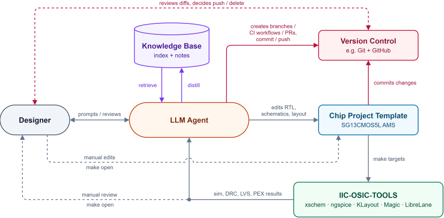
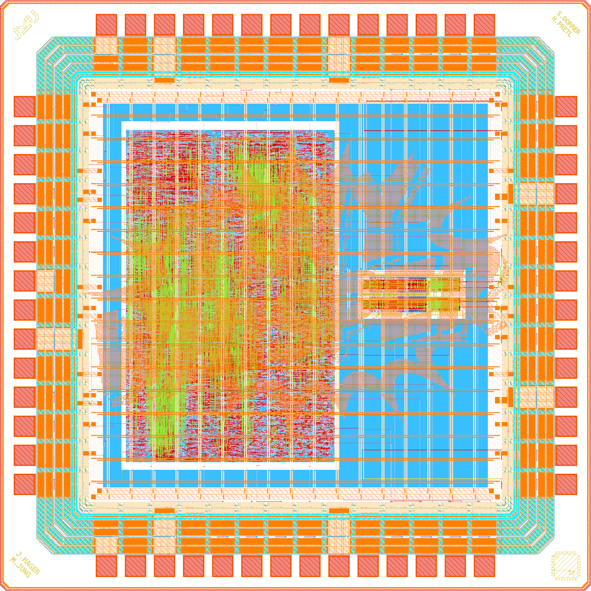
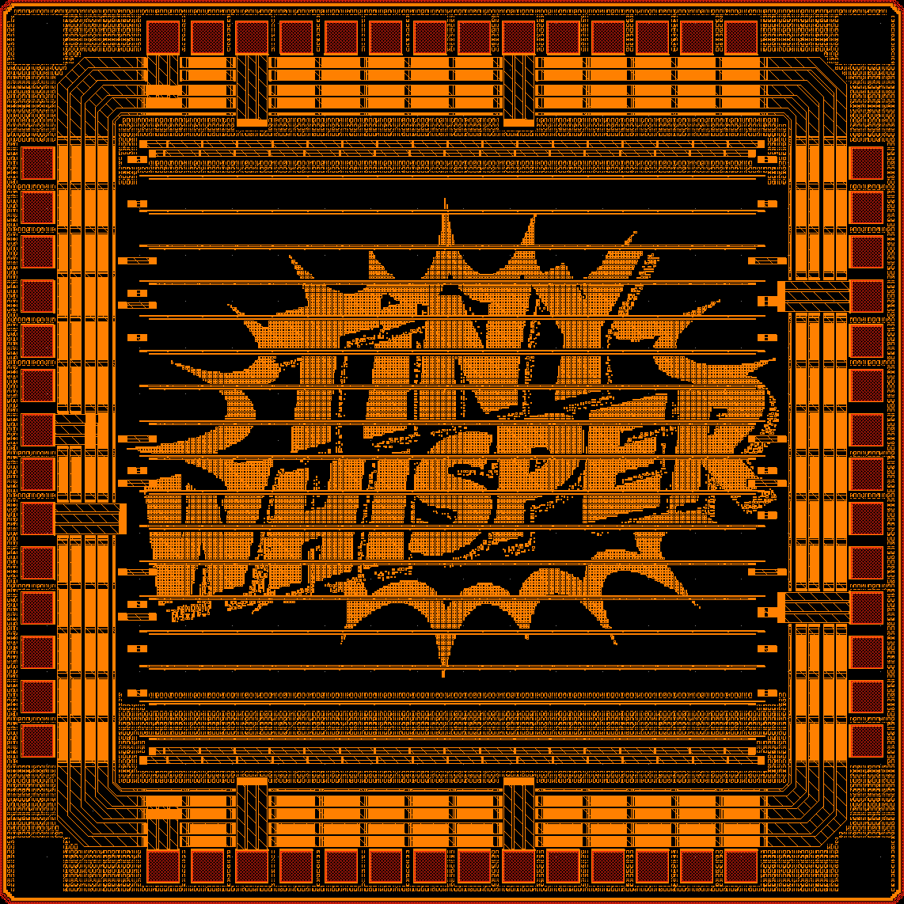

::: {.content-hidden}
Copyright (C) 2026 Simon Dorrer and co-authors (simon.dorrer@jku.at)

Licensed under the Apache License, Version 2.0 (the "License");
you may not use this file except in compliance with the License.
You may obtain a copy of the License at

    http://www.apache.org/licenses/LICENSE-2.0

Unless required by applicable law or agreed to in writing, software
distributed under the License is distributed on an "AS IS" BASIS,
WITHOUT WARRANTIES OR CONDITIONS OF ANY KIND, either express or implied.
See the License for the specific language governing permissions and
limitations under the License.
:::

# Introduction {#sec-intro}

This is the material for an introductory-level course on digital **very-large-scale integration (VLSI)** design, held at JKU under course number 336.051 ("KV: VLSI Design").

The course teaches the design of **digital application-specific integrated circuits (ASICs)** with a modern, fully **open-source** RTL-to-GDSII flow, from the register-transfer level (RTL) to the layout. We model hardware in **SystemVerilog**, verify it with **cocotb** (Python), inspect waveforms in **GTKWave**/**Surfer**, and harden a design and assemble it into a complete, tapeout-ready chip, including the padframe, with **LibreLane** on the **IHP SG13CMOS5L** 130 nm open process design kit (PDK). In the course project, you take your own **RISC-V system-on-chip (SoC)** all the way to a tapeout-ready chip.

::: {.callout-important}
All course material (the source of this document, the SystemVerilog code, the cocotb testbenches, the LibreLane configurations, and the Python sources for all figures) is made publicly available on GitHub ([follow this link](https://github.com/iic-jku/vlsi-design)) and shared under the Apache-2.0 license.

Please feel free to submit pull requests on GitHub to fix errors and omissions!
:::

::: {.callout-important}
Please use the IIC-OSIC-TOOLS image with tag `2026.10` or later. It contains all tools and the PDK used in this course. Inside the container, `echo $IIC_OSIC_TOOLS_VERSION` prints the tag. An existing container keeps its image when it is started again, so to update, remove the container (the `.sh` start scripts offer this, the `.bat` scripts print the command), pull the new image with `docker pull hpretl/iic-osic-tools:latest`, and run the start script again. Your designs in `/foss/designs` are kept (@sec-intro-install-local).
:::

## Preamble on the Use of AI {#sec-intro-ai}

Artificial intelligence offers impressive possibilities today: it can explain how things are connected, provide examples, help with debugging, or point out different ways to solve a problem. Precisely for this reason, however, there is a risk of relying too heavily on such tools while learning, and thereby not practicing enough of exactly those skills that this course is meant to build.

In the written exam, you will have to solve problems without any technical aids. There, the only thing that counts is which concepts, methods, and skills you have mastered yourself. Likewise, in the oral presentation of your project, you have to be able to explain what you did and why you did it.

If you want to complete a long-distance run in a few months, you have to build up your own endurance. You could, of course, cover your weekly training route faster on an e-scooter, but that does not train your ability to run the distance yourself. The same holds for your studies: if AI regularly does the actual thinking for you, you will not sufficiently build up the skills you need.

So feel free to use AI as a learning partner, but not as a substitute for your own thinking. Always try to understand and solve a problem on your own first. Afterwards, use AI, for example, to check your solution, to learn about an alternative approach, or to have a difficult topic explained to you. The goal of this course is not to arrive at a correct answer as quickly as possible, but to develop the competence to get there on your own.

In the end, you are here to learn something, so do not cheat yourself! This matters beyond the course, too: as AI agents take over more and more routine design work (see @sec-intro-agentic), engineers who know how to prompt these tools and, above all, how to critically review their results will always be needed. And you can only review what you understand yourself.

## Learning Objectives {#sec-intro-objectives}

After completing this course, you will be able to:

- work with the **IIC-OSIC-TOOLS** container and manage your designs with **Git** and **GitHub**
- read and write synthesizable **SystemVerilog** RTL for synchronous digital designs, and translate idiomatic VHDL into idiomatic SystemVerilog
- apply **modeling guidelines** that make RTL ready for an ASIC (a simulation that matches the netlist, resets, no FPGA habits, registered macro boundaries, the right architecture)
- verify RTL with **self-checking cocotb testbenches** and reason about coverage and corner cases
- explain how logic synthesis maps RTL onto a **standard-cell library**, and prove the resulting netlist equivalent to the RTL with **logic equivalence checking (LEC)**
- analyze timing using the concepts of **setup/hold, propagation delay, clock skew, and static timing analysis (STA)**, and write the **timing constraints** that STA checks against
- reduce the dynamic power of a design with **clock gating**
- handle **multiple clock domains** and **resets** safely with synchronizers and reason about metastability
- explain **design for test (DFT)**, the stuck-at fault model, scan chains, and test coverage
- understand and explain the **RTL-to-GDSII flow** (synthesis, floorplanning, placement, clock tree synthesis, routing, signoff) and drive it with **LibreLane**
- integrate a digital macro into a **padframe** and assemble a complete, **tapeout-ready ASIC** with open-source tools
- design, verify, harden, and document a **RISC-V SoC with your own extension** as a capstone project
- optionally, use **large language model (LLM) agents** efficiently, and critically, in a chip design workflow

## Prerequisites {#sec-intro-prerequisites}

The course is an elective for students of the Bachelor's program in Computer Science and of the Master's program in Electronics and Information Technology (ELIT). To follow it, you should bring:

- a basic understanding of CMOS transistors
- a good understanding of digital logic (gates, flip-flops, etc.)
- basic experience with a hardware description language (e.g., VHDL)
- your own laptop with at least 20 GB of free disk space for VS Code, Git, and the IIC-OSIC-TOOLS (see @sec-intro-installation)

The following JKU courses, whose material is also openly available, complement this course well but are not required:

- **KV Analog Circuit Design**: <https://github.com/iic-jku/analog-circuit-design>
- **KV Design of Complex Integrated Circuits**: <https://github.com/iic-jku/design-complex-ic>

## Course Content {#sec-intro-content}

After this introduction, the course covers the following topics:

1. hardware description with SystemVerilog, and modeling guidelines for synthesizable RTL (@sec-sv-crashcourse, @sec-modeling)
2. functional verification with cocotb (@sec-verification)
3. logic synthesis, the standard-cell library, and logic equivalence checking (@sec-synthesis-lib)
4. sequential elements, static timing analysis, and timing constraints (@sec-sequential)
5. synthesis optimizations and low-power design (@sec-synth-opt)
6. clock domain crossing and resets, and design for test (@sec-cdc, @sec-dft)
7. the RTL-to-GDSII flow with LibreLane, chip assembly, and padframe (@sec-digital-flow)
8. the project: a tapeout-ready RISC-V SoC (@sec-project)

The appendix lists possible questions for the written exam (@sec-app-exam).

::: {.callout-note title="Further Reading"}
These notes are self-contained but kept concise. For depth we recommend:

- [@Harris_Harris_2021] for digital design and RISC-V computer architecture.
- [@Weste_Harris_2010] for CMOS VLSI design from circuits to systems.
- [@Cummings_CDC] for clock-domain-crossing techniques in SystemVerilog.
:::

## Grading {#sec-intro-grading}

The grade consists of two equally weighted parts:

- **Part 1, Theory (50 %)**: The theoretical lectures are mixed with small examples. This part is assessed by a **written exam before Christmas, on December 17, 2026**. The exam is closed book, allows no technical aids, and is based on the questions in @sec-app-exam, partly with other numbers, circuits, or code.
- **Part 2, Project (50 %)**: You implement a complete, **tapeout-ready RISC-V SoC** with your **own extension** (analog or digital) and present your work in an **oral presentation** (@sec-project).

::: {.callout-tip}
The best project might actually be taped out! Moreover, the project can be extended into a seminar work (+3 ECTS) or a thesis.
:::

## Why ASICs? {#sec-intro-why-asic}

Application-specific integrated circuits are designed when standard, off-the-shelf components cannot meet the requirements. Typical motivations are:

- **Specification**: performance, power, or size targets unreachable with standard parts.
- **Integration**: combining digital logic, analog circuits, and on-chip memory into a single mixed-signal chip.
- **Economics**: at high volume the per-unit cost drops dramatically, and integrating more functionality into one chip reduces system cost.

Historically, the cost *per transistor* has fallen by orders of magnitude as integration density doubled roughly every 18 to 24 months (**Moore's law**). What was once only affordable to large companies is, with open-source PDKs and tools, now accessible to students and researchers.

## A Taxonomy of ASICs {#sec-intro-taxonomy}

ASIC implementation styles trade off non-recurring engineering (NRE) cost, unit cost, performance, and design effort. @tbl-asic-styles compares them, from programmable logic devices (PLDs) and field-programmable gate arrays (FPGAs) to full-custom ICs. The more masks and design effort a style needs, the higher its NRE cost, and the lower its unit cost at high volume.

| Style | Masks | Effort | NRE / unit cost | Typical use |
|:-----------------------|:-----------------|:------------|:--------------------|:----------------------------|
| **PLD / FPGA** | none | low | lowest / highest | prototypes, low volume |
| **Gate array / sea-of-gates** | only wiring layers | medium | low / medium | medium volume |
| **Standard-cell IC (CBIC)** | all layers | medium to high | high / low | the workhorse of digital design |
| **Full-custom IC** | all layers, hand-crafted | very high | highest / lowest | highest performance |

: ASIC implementation styles {#tbl-asic-styles}

This course focuses on the **standard-cell** style: we describe behavior in SystemVerilog and let the synthesis tool map it onto a library of pre-characterized standard cells from the SG13CMOS5L PDK [@IHP_OpenPDK].

## The Digital Design Flow {#sec-intro-flow}

The core of this course is the digital design flow that turns a hardware description into a manufacturable layout. Since this layout is traditionally handed over to the foundry in the GDSII file format, it is called the **RTL-to-GDSII** (or simply RTL-to-GDS) flow. @fig-design-flow shows its main steps.



The flow starts with the **RTL design**, described in a hardware description language (HDL) such as SystemVerilog. Long before any layout exists, the RTL is checked: **lint** finds suspicious code without running it, **RTL simulation** runs it against a testbench, and designs with several clocks need a **review** of their **clock domain crossings (CDC)** (@sec-cdc).

**Logic synthesis** translates the RTL into a gate-level netlist of standard cells of the target technology, guided by constraints such as the clock frequency, written in SDC (Synopsys Design Constraints). The netlist is checked as well: **static timing analysis (STA)** checks the timing of every path with an ideal clock, **gate-level simulation** (**pre-layout simulation**) repeats the tests with the same testbench, **power analysis** estimates the power consumption, **logic equivalence checking** proves that the netlist implements the RTL, and **design for test** inserts scan chains and generates test patterns (automatic test pattern generation, ATPG), so that every fabricated chip can be tested (@sec-dft). Every bug found here leads back to the RTL.

The physical implementation then turns the netlist into a layout. **Floorplanning** defines the size of the die and the core, the placement of I/Os and macros, and the power grid. **Placement** positions the standard cells, **clock tree synthesis (CTS)** builds a balanced clock distribution network, and **routing** connects all cells with metal wires.

Only after routing are the resistances and capacitances of the wires known. **Parasitic extraction** annotates them to the netlist, on which STA and **post-layout simulation** check whether the design still meets its timing and functional specification. Violations are fixed by revisiting floorplanning and placement or, if this is not enough, by changing the RTL itself (**design iteration**), e.g., by pipelining a critical path. Finally, the layout is written in the GDSII format, and **physical verification** checks it against the design rules of the foundry (design rule check, DRC) and against the netlist (layout versus schematic, LVS). A failed check leads back to routing. Only a design that passes all checks goes to **tapeout**, i.e., is sent to the foundry for fabrication.

LibreLane (@sec-digital-flow) runs the steps in the dashed region of @fig-design-flow. In this course, the checks beside it run separately, although LibreLane also runs lint and STA on its own. For a complete chip, the hardened digital macro is finally integrated into a **padframe** and assembled into the chip top level (@sec-digital-flow). @tbl-flow-tools lists the open-source tools used in this course for each step and where the step is covered.

| Flow step | Open-source tool | Covered in |
|:----------------------------------|:------------------------------------|:------------------------------|
| HDL | SystemVerilog | @sec-sv-crashcourse, @sec-modeling |
| Lint | Verilator | @sec-sv-crashcourse, @sec-modeling |
| RTL, pre- and post-layout simulation | cocotb or a SystemVerilog testbench with Icarus Verilog, or Verilator for RTL, waveforms in GTKWave or Surfer | @sec-verification, @sec-digital-flow |
| CDC review | by hand, no tool in this course | @sec-cdc |
| Logic synthesis | Yosys | @sec-synthesis-lib, @sec-synth-opt |
| Logic equivalence checking | EQY, Yosys `equiv_*` commands | @sec-synthesis-lib, @sec-dft, @sec-digital-flow |
| Scan insertion and test generation | OpenROAD, Fault | @sec-dft |
| Floorplanning, placement, CTS, routing | OpenROAD | @sec-digital-flow |
| Parasitic extraction | OpenRCX | @sec-digital-flow |
| Static timing analysis | OpenSTA | @sec-sequential, @sec-digital-flow |
| Power analysis | OpenSTA | @sec-synth-opt |
| Physical verification | Magic and KLayout (DRC), Netgen and KLayout (LVS) | @sec-digital-flow |
| Chip assembly and padframe | LibreLane with the AMS chip template | @sec-digital-flow, @sec-project |

: Steps of the RTL-to-GDSII flow, the open-source tools used for them in this course, and where they are covered. LibreLane orchestrates the steps in the dashed region of @fig-design-flow. The PDK is IHP SG13CMOS5L (130 nm). {#tbl-flow-tools}

## The IIC-OSIC-TOOLS Container {#sec-intro-tools}

The legacy version of this course relied on commercial tools (Vivado, ModelSim, Synopsys Design Compiler, Cadence Innovus, TetraMAX, PrimeTime). This edition is built entirely on open-source tools, all pre-installed in the **[IIC-OSIC-TOOLS](https://github.com/iic-jku/IIC-OSIC-TOOLS)** container [@IIC_OSIC_TOOLS]. This all-in-one Docker/Podman image for analog and digital IC design is curated at JKU and runs natively on `x86_64` and `arm64` machines (e.g., Apple Silicon). Since everyone uses the identical container, results are reproducible, and "works on my machine" problems disappear.

As @tbl-iic-osic-tools shows, the container covers much more than this course needs: full-custom (analog) design with schematic entry, analog simulation, layout, and electromagnetic (EM) simulation, semi-custom (digital) design with simulation, synthesis, and complete RTL-to-GDSII flows, as well as several open-source PDKs. In this course, we mainly use the digital tools (@tbl-flow-tools) with the IHP SG13CMOS5L PDK, and the analog tools appear in the AMS chip template (@sec-intro-template).

| Category | Tools and PDKs |
|---------|----------------|
| Schematic entry | Xschem, Qucs-S |
| Analog simulation | ngspice, Xyce, VACASK, CACE |
| Layout editing | Magic, KLayout, GDSFactory |
| Digital simulation and waveforms | Icarus Verilog, Verilator, cocotb, GTKWave, Surfer |
| Logic synthesis | Yosys (with the slang and GHDL front ends), ABC |
| RTL-to-GDSII flows | LibreLane, OpenROAD Flow Scripts, SiliconCompiler, QFlow |
| Place and route, STA, extraction | OpenROAD, OpenSTA, OpenRCX |
| DRC, LVS, and parasitic extraction | Magic, KLayout, Netgen, KLayout-PEX |
| EM simulation | Palace, openEMS |
| PDKs | sky130A, gf180mcuD, ihp-sg13g2, ihp-sg13cmos5l |

: A selection of the tools and PDKs in the IIC-OSIC-TOOLS container {#tbl-iic-osic-tools}

### Open-Source and Commercial Tools {#sec-intro-tools-commercial}

Industry builds most chips with commercial tools, and you will meet their names in job descriptions. @tbl-tools-gaps lists examples of them for each step of the flow and the main gap of the open-source tool. Many of its terms come up only in later chapters (@tbl-flow-tools says where), so take it as a reference to come back to. This course does not use OpenCDC [@OpenCDC] or `read_upf`, which reads the Unified Power Format (UPF). We ran no commercial tools: the table rests on public documentation, on runs of the open-source tools, and on the two comparisons below.

The gaps are of two kinds. The first is missing features. Some of them matter more in an advanced node or a large chip than in the small blocks of this course at 130 nm, e.g., crosstalk, where a switching neighbor changes the delay of a wire, dynamic IR drop, the short dips of the supply voltage when many cells switch at once, and electromigration, the wear of a wire at a high current density.

The second is the quality of the results. For a finite-state machine at 50 MHz in the IHP 130 nm open PDK, with the same constraints and the same switching activity, an open-source flow with Yosys and OpenROAD needed 53 % more area and 118 % more power than a commercial flow with Cadence Genus and Innovus [@Freitas_2025]. An earlier comparison of RISC-V designs reports 1.24 times the area of a commercial tool after synthesis with Yosys at 130 nm and 1.49 times at 40 nm. Yosys ran faster than the commercial tool there, while the place-and-route steps of OpenROAD took 2.13 times as long [@Sanchez_Lopera_2022].

All of this is a snapshot of tools that change quickly. Both comparisons used older tool versions, and within weeks after image `2026.10` was built, OpenSTA gained an experimental crosstalk delay analysis, which needs library models that SG13CMOS5L does not have, and OpenROAD a reordering of the scan chains. The script [`scripts/check_intro.sh`](/blob/main/scripts/check_intro.sh) tests what it can of the table in the image, and the [sv-tests results](https://chipsalliance.github.io/sv-tests-results/) show the language coverage of each tool.

| Flow step | Open-source tool | Commercial tools (examples) | Main gap of the open-source tool |
|:------------------|:------------------|:----------------------------|:------------------------------------|
| Lint | Verilator | Synopsys VC SpyGlass, Siemens Questa Lint | No testability rules, configurable naming rules only in Verible |
| Simulation | Icarus Verilog, Verilator | Cadence Xcelium, Synopsys VCS, Siemens Questa One Sim | Verilator: two-state, no SDF. Icarus Verilog: no SDF timing checks. Neither covers all of SystemVerilog |
| Clock domain crossings (CDC) | [OpenCDC](https://github.com/Ayoubbelguellaoui/CDC) | Siemens Questa CDC, Synopsys VC SpyGlass CDC | Under development: false errors on correct designs, missed crossings (@sec-cdc-sdc) |
| Logic synthesis | Yosys, ABC | Synopsys Design Compiler, Cadence Genus | Larger area, higher power, retiming only through ABC |
| Logic equivalence checking | EQY, Yosys `equiv_*` | Cadence Conformal, Synopsys Formality | Language coverage of the Yosys front ends, the EQY step of LibreLane prepares cell models only for sky130 |
| Scan and test generation | OpenROAD, Fault | Synopsys TestMAX, Siemens Tessent | Stuck-at faults only, mostly on whole nets |
| Place and route | OpenROAD | Cadence Innovus, Synopsys Fusion Compiler | Larger area, higher power, longer run times |
| Parasitic extraction | OpenRCX | Cadence Quantus, Synopsys StarRC | Rule-based, accuracy depends on the calibrated rules of the PDK |
| Static timing analysis | OpenSTA | Synopsys PrimeTime, Cadence Tempus | No crosstalk delay analysis |
| Power analysis | OpenSTA | Synopsys PrimePower, Cadence Voltus, Cadence Joules | Average power only, no peak power, no estimate at RTL |
| IR drop and electromigration | OpenROAD (PDNSim) | Cadence Voltus | Static IR drop of the power grid only, no electromigration limits, no signal wires |
| DRC and LVS | Magic, KLayout, Netgen | Siemens Calibre, Cadence Pegasus, Synopsys IC Validator | A commercial PDK usually ships its rule decks only for commercial tools |
| Power intent (UPF) | OpenROAD `read_upf` | Cadence Conformal Low Power, Synopsys VC LP | Subset of UPF, no open-source UPF checker known to us |

: Examples of commercial tools for each step of the flow and the main gap of the open-source tool, as of image `2026.10` {#tbl-tools-gaps}

For this course, the gaps are a fair price. Every student gets the same tools without a license or a non-disclosure agreement, you can read what each tool does, and the flow takes a design all the way to tapeout (@sec-intro-tinywhisper).

## The AMS Chip Template {#sec-intro-template}

Hardening a single digital block is only part of the way to a chip. A tapeout-ready chip additionally needs a padframe and a seal ring, the placement and wiring of all macros on the top level, logo and metal-fill insertion, full-chip verification, and finally a bonding diagram for packaging. To get there without fighting the tools, this course builds on the **[ihp-sg13cmos5l-ams-chip-template](https://github.com/iic-jku/ihp-sg13cmos5l-ams-chip-template)** [@AMS_Chip_Template], an open-source GitHub template repository for analog mixed-signal (AMS) chips developed at JKU:

- It is released under the permissive **Solderpad Hardware License v2.1**.
- Create your own repository with GitHub's *Use this template* button (or simply `git clone` it), enter the IIC-OSIC-TOOLS container, and run `make all`. The result is a **tapeout-ready AMS chip**.
- A step-by-step **[tutorial](https://iic-jku.github.io/ihp-sg13cmos5l-ams-chip-template/index.html)**, written in Quarto, walks through all IC design steps on IHP's 130 nm process, with simple exercises to learn by doing. You start your project with this tutorial (@sec-project).
- **Regression tests** via GitHub Actions ensure that the flow keeps working with every new release of the tools.

The template is also available for the ihp-sg13g2, sky130A, and gf180mcuD open PDKs, and several chips have already been taped out with it, including TinyWhisper (@sec-intro-tinywhisper).

### Flow Overview {#sec-intro-template-flow}

The Makefile-driven flow of the template covers:

- simulation, linting, and hardening of the RTL
- layout checks and reports of the hardened digital macro
- simulation of all analog testbenches, including process, voltage, and temperature (PVT) corners and Monte Carlo (MC) analysis
- layout checks of the analog and digital blocks (DRC, LVS, and parasitic extraction, PEX)
- digital-on-top assembly of the chip top level and its layout check (DRC), including
    - seal ring and padframe generation
    - macro placement and wiring, also with non-default rules (NDRs)
    - logo and fill insertion
- full top-level LVS and simulation without black-boxing
- generation of the bonding diagram

### Folder Structure and Makefiles {#sec-intro-template-structure}

The folder structure of the template was discussed with the FOSSi community. Every macro in `macros/` (e.g., the digital `counter` and the analog `inverter` examples) follows the same scheme as the chip top level, with its own `Makefile` and folders such as `rtl/`, `testbenches/`, `schematic/`, `layout/`, `netlist/`, `verification/`, and `final/`. Since a macro can itself contain macros, the structure is recursive. This makes it easy to share macros between projects and to reproduce the results of others.

At the top level, `make all` runs four steps:

1. `make build-all` builds the bondpad, the logos, all enabled macros, and finally the chip top level (LibreLane assembly, reports, GDS, netlists, logo and fill insertion, and renders)
2. `make magic-drc` (or `make klayout-drc`) checks the final layout of the chip
3. `make sim-all` simulates the chip (RTL and gate-level simulation with cocotb, gate-level simulation with Xschem)
4. `make bondplan` generates the bonding diagram for packaging

Targets that build an intellectual property (IP) block or a macro recursively call the `Makefile` of that block.

## Agentic AI Chip Design {#sec-intro-agentic}

Large language model (LLM) agents are increasingly able to operate a complete chip design environment: they do not only answer questions, but also edit design files, run tools, interpret the results, and iterate. @fig-llm-agent-flow shows such an agentic workflow.

{#fig-llm-agent-flow fig-alt="Block diagram. A designer sends prompts to an LLM agent and reviews its work. The agent edits a chip project based on the AMS chip template and runs its make targets, which call the tools of the IIC-OSIC-TOOLS. The results flow back to the agent and the designer, the agent reads and writes a knowledge base, and all changes go through Git and GitHub."}

The designer interacts with the LLM agent through prompts and reviews. The agent edits the RTL, schematics, and layout of a chip project based on the AMS chip template (@sec-intro-template) and runs its make targets, which call the tools of the IIC-OSIC-TOOLS. The results of simulation, DRC, LVS, and PEX flow back to the agent and to the designer. A knowledge base (an index plus notes) lets the agent retrieve relevant information and distill new insights for later sessions. All changes are tracked in version control (e.g., Git and GitHub): the agent creates branches, commits and pushes changes, sets up continuous integration (CI) workflows, and opens pull requests, while the designer reviews the diffs and decides whether changes are pushed or discarded. Of course, the designer can still edit the project manually at any time.

Such a workflow is only possible because every step of the flow is scripted, every tool runs in a reproducible container, and every result is machine-readable. Note the role of the designer: they remain responsible for the design and have to judge whether the results of the agent are correct, which brings us back to @sec-intro-ai. Using LLM agents efficiently is an optional learning objective of this course.

## Example: The TinyWhisper SoC {#sec-intro-tinywhisper}

What is possible with open-source tools and the AMS chip template is demonstrated by **[TinyWhisper](https://github.com/iic-jku/TinyWhisper)**, an open-source, fully integrated, multi-mode short-wave transmitter for amateur radio, developed in a cooperation between JMU Würzburg and JKU Linz. TinyWhisper combines a RISC-V CPU with peripherals, custom digital signal generation, and an analog front-end on one chip, so it is a good preview of what you will build in the course project. The block diagram and all design files can be found in the [repository](https://github.com/iic-jku/TinyWhisper), and the full documentation is available [online](https://iic-jku.github.io/TinyWhisper/index.html).

### Weak Signal Propagation Reporter

TinyWhisper targets the **Weak Signal Propagation Reporter (WSPR)** protocol, a popular digital mode in amateur (ham) radio for propagation studies in the 80 m to 10 m bands. A WSPR transmitter sends a short message (callsign, location, and transmit power) using 4-FSK modulation with a tone spacing of $\Delta f = 1.46\,\mathrm{Hz}$ and a symbol duration of $T = 0.683\,\mathrm{s}$. Receivers can decode signals down to a signal-to-noise ratio of $-31\,\mathrm{dB}$ in a 2500 Hz bandwidth and report everything they receive to a central database via the Internet ([WSPRnet map](https://www.wsprnet.org/drupal/wsprnet/map)). On TinyWhisper, the modem part (coding, framing, and symbol mapping) is implemented in firmware written in C, which runs on the on-chip RISC-V CPU.

### Chip Overview

@tbl-tinywhisper summarizes the key parameters of the chip, and @fig-tinywhisper shows renders of its layout. The custom logo on the topmost metal layer (@fig-tinywhisper-tm2) was generated with the tool [ArtistIC](https://arxiv.org/abs/2502.02626) of the PULP platform. TinyWhisper was taped out in the IHP open multi-project wafer (MPW) run in March 2026 and, at the time of writing (October 2026), is still in fabrication.

::: {#fig-tinywhisper layout-ncol=2}

{#fig-tinywhisper-top fig-alt="Layout render of the TinyWhisper chip on a white background, with the pad ring around the core, the digital RISC-V CPU on the left, and the analog IQ modulator on the right."}

{#fig-tinywhisper-tm2 fig-alt="Render of the TopMetal2 layer of TinyWhisper on a black background, showing the custom logo and the metal fill around it."}

Renders of the taped-out TinyWhisper chip (2000 µm × 2000 µm), taken from the [TinyWhisper repository](https://github.com/iic-jku/TinyWhisper).
:::

| Parameter | Value |
|---|---|
| Technology | IHP SG13CMOS (130 nm CMOS), open PDK |
| Die area | 2000 µm × 2000 µm (4 mm²) |
| Core area | 1270 µm × 1270 µm (1.61 mm²) |
| Clock frequency | 56 MHz |
| Core / I/O supply voltage | 1.5 V / 3.3 V |
| Pads | 56 |
| Package | QFN-48 (8 pads bonded directly to package ground) |

: Key parameters of the TinyWhisper chip {#tbl-tinywhisper}

The **digital core** is built around an embedded RISC-V CPU implementing `rv32e_zicsr`, i.e., the 32-bit embedded base integer instruction set with 16 registers plus the extension for control and status registers. The CPU is a multi-cycle design without pipelining, running at 56 MHz, and accesses its SPI, I²C, UART, and GPIO peripherals as memory-mapped I/O. The IQ baseband signals are generated in hardware: a 30-bit iterative CORDIC computes sine and cosine with a frequency resolution of $\Delta f = f_\mathrm{clk}/2^{30} \approx 0.05\,\mathrm{Hz}$, and a single-bit second-order delta-sigma modulator (oversampling ratio up to 256) converts its output into a bitstream for the analog front-end. Both are configurable via software. Furthermore, the digital core divides the clock down to the 25 % duty-cycle local oscillator (LO) signals of the mixers, which cover the 80 m, 40 m, 20 m, and 10 m bands.

The RISC-V CPU has already been proven in silicon: it was part of a multi-project student chip (with digital filters, mini games, and more) fabricated in the GlobalFoundries GF180MCU technology in the first [wafer.space](https://wafer.space) run ([GitHub](https://github.com/iic-jku/gf180mcu-jku-projects)). On a breadboard, with the firmware supplied by an external microcontroller board and a discrete third-order multiple-feedback low-pass filter, the chip generates a clean baseband signal.

The **analog front-end** is an IQ modulator. Each of its two channels consists of a third-order multiple-feedback (MFB) Butterworth low-pass filter with a cutoff frequency of 400 kHz, built around a Barthélemy/Manfredini inverter-based operational transconductance amplifier (OTA), followed by a passive CMOS voltage-mode mixer with simple transmission-gate (TG) switches and a single-to-differential conversion circuit. Remarkably, the front-end consists only of inverter- and TG-based circuits. As an IQ transmitter, it supports not only WSPR but also other modes such as FT8, SSB, and CW.

Finally, even the **bonding diagram** for packaging is generated automatically: a Python script reads a configuration file with the pinout and placement, extracts the relevant layers (top metal and pads) from the layout, places the chip in the package, determines the pad centers, draws the bond wires, and renders the result as GDS. This is exactly what `make bondplan` of the AMS chip template does (@sec-intro-template-structure).

> "The aha moment of seeing your circuit come to life will stay long after the equations are forgotten." (Peter Kinget)

## Tools Installation {#sec-intro-installation}

You can either install the IIC-OSIC-TOOLS locally on your own laptop or use a workspace on a JKU server via your browser.

### Local Installation {#sec-intro-install-local}

1. Install **Visual Studio Code** from <https://code.visualstudio.com>.
2. Run the interactive **installer**. It sets up Git, Docker (or Podman), WSL2 on Windows or XQuartz on macOS, and clones the IIC-OSIC-TOOLS repository (by default to `~/iic-osic-tools`). Every action asks for your confirmation first.

    On Windows, open PowerShell **as Administrator** and run:

    ```powershell
    irm https://osic.tools/install.ps1 | iex
    ```

    On macOS and Linux, run:

    ```bash
    curl -fsSL https://osic.tools/install.sh | bash
    ```

3. Reboot your computer. On Windows and macOS, start Docker Desktop once afterwards.
4. Start the container from within the `iic-osic-tools` folder with `.\start_vnc.bat` (Windows) or `./start_vnc.sh` (macOS and Linux), and open <http://localhost/?password=abc123> in your browser. The first start downloads the image (about 4 GB), so be patient. With Podman, the default port is 8080 instead of 80, and the start script always prints the correct URL. On macOS and Linux, `./start_x.sh` alternatively shows the tools directly on your desktop via X11.
5. Store your designs in `~/eda/designs` on your laptop (`%USERPROFILE%\eda\designs` on Windows), which appears as `/foss/designs` inside the container. Only this folder persists when the container is removed or updated.

::: {.callout-tip}
Piping a script from the Internet directly into a shell runs it without review. If you prefer to inspect the installer first, download it, read it, and run it locally, e.g., `curl -fsSLO https://osic.tools/install.sh && less install.sh && bash install.sh`.
:::

### Containerized On-Demand Workspace System (COWS) {#sec-intro-install-cows}

If you cannot or do not want to install the tools locally, you can use the **Containerized On-Demand Workspace System (COWS)** instead, which provides a ready-to-use design environment in your browser:

1. Open COWS at <https://jku128011.riic.uni-linz.ac.at/>.
2. Log in with the credentials provided to you and change your password.
3. Create a workspace: go to *Workspaces*, click *Create workspace*, enter a *Workspace name*, and select the *KV VLSI Design 26/27* template.
4. Start the workspace. Its *Status* should change to *Running*.
5. Open the workspace by clicking its name.

Enjoy your workspace, and happy designing!
